# Schematic to Model

Use `SCHEMATIC_TO_MODEL` to design a mechanically coherent game object, approve its complete schematic, build its parts separately and assemble a model whose components remain independently addressable. Suitable subjects include vehicles, opening devices and vessels with curved hulls.

A **part definition** describes one reusable component, such as a bolt or wheel. A **physical instance** identifies each actual occurrence. Four identical wheels may share geometry, but each keeps its own object, transform, pivot and movement. Functional internals, fasteners, wires and hoses must be explicitly designed; a detail description does not add omitted geometry automatically.

Included in stable `5.2.0`. Use [package installation and managed updates](INSTALLER.md), then explicitly initialize/build the recorded native runtime. Installing tooling does not update an existing pinned host or grant model/runtime acceptance.

## Start with the object

You can ask in ordinary language:

```text
Use schematic to model for a compact inspection rover in the project's style. Agree on dimensions, materials, wheel and steering assemblies, service panels, fasteners and wiring. Show all schematic views, internal sections, exploded assembly, connections and the bill of materials together. Explain assumptions and simplified systems before asking for my whole-design approval. Build the parts separately and retain their pivots and flexible rigs for later animation. Deliver the package outside the game.
```

Capture purpose, appearance, dimensions, internal systems, moving parts, inspection needs, tolerances, detail and finite budgets before approval. Separate reference observations from assumptions and unresolved or simplified systems. Reference pictures can inform appearance; they do not establish authoritative dimensions automatically. Automatic CAD/raster conversion and image-to-mesh reconstruction are deferred.

```mermaid
flowchart LR
    Brief[Object and budgets] --> Design[Dimensioned complete design]
    Design --> Approve[Human whole-design approval]
    Approve --> Parts[Build each part definition]
    Parts --> Assembly[Assemble physical instances]
    Assembly --> Motion[Prove sampled articulation]
    Motion --> Export[Export and independently re-import]
    Export --> Review[Complete views and independent review]
    Review --> Human[Separate human model acceptance]
```



Hephaera owns selection, rights, approvals and continuation. The pinned Bubo runtime owns dimensional/connectivity validation, drawings, construction, motion evaluation and export verification. Engine integration, finished animation and runtime asset promotion are separate work.

## Selection and prerequisites

Resolve the engine and coordinating skill before production:

```bash
bash .hephaera/commands/resolve-engine.sh
bash .hephaera/commands/resolve-skill.sh build-schematic-models
bash .hephaera/commands/resolve-art-pipeline.sh \
  --override SCHEMATIC_TO_MODEL --json \
  --evidence .hephaera/.cache/tasks/sc/schematic-selection.json
```

Use an existing tracked task in place of `sc`. Require the skill resolver's `compatible: true`. The selection receipt binds the actual `STYLE.md` hash and applies only to that task. Pass it to `init --selection`. It preserves the project's primary pipeline, default `PROOF_TO_MODEL`, engine and independent AUDIO/MUSIC/VOICE domains. An explicitly requested project-wide change uses the normal style-contract regeneration workflow.

Use the explicitly built, verified runtime recorded in [the Bubo lock](../runtime/bubo.lock.json). This implementation pins actual reviewed Bubo merge `7ab99a9f12761095e5a3ee5cfb37d2a679b026a7`, execution API 2; choose a Hephaera version that contains this integration. Source merges do not update existing npm/NuGet package versions or package-managed installations automatically.

Pure design initialization, validation and preview require no Blender or media provider. Native construction, assembly, proof, export and review currently require an existing selected Blender 4.5 LTS executable and supported 64-bit Windows aggregate committed-memory enforcement. Linux policy/contract CI does not certify native Blender production there. `doctor` reports actual missing prerequisites; a capability declaration or installation receipt does not prove readiness.

Keep project/task/asset/version paths short on Windows. The host checks known prototype, sampled-geometry, nested export/re-import/review and drawing paths before launching Blender. These necessary checks do not certify every SDK internal path. No path or tool failure installs software, changes system settings or selects another backend.

Pure procedural design needs no `MEDIA.md`. Generated references retain their own media authorization, rights and attempt budgets. Inspect configured external asset libraries before replacement work and use only rights-checked project-local copies; the original libraries remain read-only.

## Design contract and units

The [native design contract](../runtime/bubo/resources/schematic-to-model/README.md) and [assembly-design schema](../runtime/bubo/resources/schematic-to-model/assembly-design.schema.json) are authoritative:

| Contract | Supported stages |
| --- | --- |
| `bubo-assembly-design/v1` | Design previews and independent part construction |
| `bubo-assembly-design/v2` with `bubo-assembly-profile/v1` | Explicit assembly, flexible rigs, sampled readiness and portable export |

A v1 approval never becomes v2 assembly approval. Adding or changing the assembly profile changes the complete design and requires a new version and approval. Native validation additionally checks relationships, construction restrictions and finite work limits; passing JSON shape alone is insufficient.

The design names reusable parts, physical instances, subassemblies, local frames, materials, interfaces, joints, mechanisms, terminals, connections, flexible routes and internal sections. Keep stable identities and an explicit hierarchy. The hierarchical bill of materials records definitions and actual quantities; every approved occurrence must remain in the canonical source and export.

Source coordinates are right-handed XY metres with Z up. Frames rotate about fixed parent X, then Y, then Z axes, then translate. Interfaces and features have explicit local frames; routes use shared world coordinates. Portable glTF uses Y-up metres with a recorded conversion. Joint angular coordinates are degrees, slider travel is metres, and screw pitch is signed metres per complete revolution. Diagnostic clip time is normalized to one second and defines no production playback speed.

Choose numerical tolerances, geometry/detail limits, sample counts, contact exemptions and preview/export-byte allowances during design. Very strict tolerances can be unrepresentable in Blender or a portable export; failure does not widen them automatically. Small hardware must retain local precision even in a large assembly.

glTF animation translations use single-precision floating-point accessors, so export and re-import can introduce rounding differences across a hierarchy. Measure the actual result against the approved tolerance at the chosen scale; a schema-valid design does not guarantee that a portable format can meet every precision requirement. See the [glTF accessor specification](https://registry.khronos.org/glTF/specs/2.0/glTF-2.0.html).

A precision failure leaves that design requirement unmet. Preserve the failed version and measured error; do not relax the verifier or round away the discrepancy. If the requirement is explicitly revised, create a new version with its parent ancestry, declare the new numerical policy and obtain fresh whole-package approval before rebuilding. A successful revised design does not turn the original failed requirement into a pass.

## Rights and process limits

`init` requires the design plus two project-local JSON records. Their exact bytes, referenced permission evidence, STYLE/selection and runtime identities become immutable per-version policy inputs. Duplicate/unknown properties, stale hashes and linked or escaping input paths are rejected.

The rights record has exactly these fields:

| Field | Value |
| --- | --- |
| `schemaVersion` | `hephaera-schematic-rights/v1` |
| `designSha256` | Lowercase SHA-256 of the exact prepared design bytes |
| `status`, `rightsHolder` | `owned` or `licensed`, and the actual nonblank holder |
| `scope` | `schematic-to-model` |
| `evidence` | Array of local `{ "path": "...", "sha256": "..." }` permission/license records |
| `referenceInputs` | Array of explicit reference records, or `[]` |

Each reference record contains `path`, `sha256`, `status`, `rightsHolder` and its own `evidence` array. Licensed designs/references require local evidence. Owned procedural work still declares both arrays. A copied Bubo example is licensed source; retain its MIT notice, source identity and modifications rather than declaring it user-owned.

A process-budget example is:

```json
{
  "schemaVersion": "hephaera-schematic-budget/v1",
  "timeoutSeconds": 900,
  "maxLogBytes": 16777216,
  "maxPrivateBytes": 8589934592
}
```

Choose these values for the actual job. They are safe integers: timeout 1..86400 seconds, log 1024..1073741824 bytes and committed memory 67108864..68719476736 bytes. Process limits supplement the design's geometry, sampling and output limits. The configured memory ceiling is not a measured resident or GPU peak. Continuation cannot replace or widen the saved allowance silently.

The immutable `hephaera-schematic-host-policy/v1` envelope binds the current inputs, selected contracts and verified runtime/build. At most 128 unique native policy references are allowed, including the envelope. Initialization rejects an excessive inventory before writing the envelope. Native work uses bounded jobs, complete-operation time/log/file/work ledgers and owned-process cancellation. Cooperative file accounting is not an operating-system disk quota.

## Commands and production order

Run from the host root with `bash .hephaera/commands/schematic-to-model.sh OPERATION`. Optional `--root PROJECT` selects the same host explicitly. Use the canonical manifest reported by `init`:

`.hephaera/.cache/tasks/<task>/schematic-to-model/<asset>/<version>/manifest.json`

| Operation | Arguments and result |
| --- | --- |
| `init` | `--task ID --asset ID --version ID --design JSON --rights JSON --budget JSON`; optional `--selection JSON --parent-manifest JSON`. Preserves originals and binds policy. |
| `doctor` | `--manifest JSON`; optional `--blender ABSOLUTE_EXECUTABLE`. Inspects actual prerequisites and prospective bounded work. |
| `validate` | `--manifest JSON`. Checks the current design and applicable approval evidence. |
| `preview` | `--manifest JSON`. Produces the complete dimensioned drawing/BOM package without approving it. |
| `record` | `--manifest JSON --kind whole-assembly-design\|independent-model\|human-model --reviewer ID --evidence JSON`. Records an actual exact-package decision. |
| `build-parts` | `--manifest JSON --blender ABSOLUTE_EXECUTABLE`. Requires whole-design approval and verifies each part definition independently. |
| `assemble` | `--manifest JSON --blender ABSOLUTE_EXECUTABLE`. Requires current parts and approved v2 assembly choices. |
| `prove-motion` | `--manifest JSON --blender ABSOLUTE_EXECUTABLE`. Evaluates the current assembly's complete declared diagnostic sampling. |
| `export` | `--manifest JSON --blender ABSOLUTE_EXECUTABLE --author ID`. Seals rest/diagnostic outputs and independently verifies their portable geometry. |
| `review` | `--manifest JSON --blender ABSOLUTE_EXECUTABLE`. Renders complete delivered-model and sampled-motion views. |
| `status` | `--manifest JSON`. Revalidates current design, parts, assembly, export, views and decisions, retaining failures. |

For prepared task-local inputs, start with:

```bash
bash .hephaera/commands/schematic-to-model.sh init \
  --task sc --asset rover --version v1 \
  --design .hephaera/.cache/tasks/sc/inputs/design.json \
  --rights .hephaera/.cache/tasks/sc/inputs/rights.json \
  --budget .hephaera/.cache/tasks/sc/inputs/budget.json \
  --selection .hephaera/.cache/tasks/sc/schematic-selection.json

manifest='.hephaera/.cache/tasks/sc/schematic-to-model/rover/v1/manifest.json'
bash .hephaera/commands/schematic-to-model.sh validate --manifest "$manifest"
bash .hephaera/commands/schematic-to-model.sh preview --manifest "$manifest"
```

Present the exact complete package and wait for the user's decision. Only then record actual whole-design evidence and proceed through `build-parts`, `assemble`, `prove-motion`, `export` and `review`. Finish with independent review, separate human model acceptance and `status`. [The argument reference](../commands/BUBO_ARGUMENTS.md#schematic-to-model) defines the accepted host flags. There is no actor, recipe, caller-supplied toolchain/output root, setup, generation, arbitrary-script or promotion operation here.

## Approve the whole schematic

Review all six dimensioned orthographic directions, every internal section, independent part sheets, exploded assembly, hierarchical BOM, connection/routing diagrams and the v2 assembly/flexible-rig policy sheets together. Check dimensions, quantities, materials, interfaces, electrical ownership, joint travel, mechanism ratios/branches, inspection access, detail and declared simplifications. Approval of one drawing or component does not approve the complete design.

Whole-design evidence uses `bubo-schematic-review/v1`: `kind`, `decision`, `human`, `reviewer`, `reason`, `asset`, `version`, `designSha256`, `designFingerprint` and `reviewedArtifacts`. Use `kind: "whole-assembly-design"`, `human: true`, the actual approved/rejected decision, and the current fingerprint plus complete artifact/hash dictionary from the preview. Store the evidence beneath the active task cache and supply it to `record`. The command checks and preserves submitted evidence; it does not authenticate a person or invent their approval.

## Build parts, assemble and prove motion

Read the native [part construction](../runtime/bubo/resources/schematic-to-model/PARTS.md) and [assembly/readiness](../runtime/bubo/resources/schematic-to-model/ASSEMBLY.md) contracts before these stages. Authoring uses only Bubo's fixed, audited, hash-bound schematic bundle on declared local working copies. This exception permits no arbitrary scripts, source execution or add-ons and does not change standalone BLENDER connected-authoring policy.

The bounded geometric subset supports boxes, cylinders, extrusions, full/partial revolves, circular sweeps and controlled lofts, with explicit additive/subtractive features. Extrusion/revolution profiles are strictly convex; lofts require corresponding convex profiles, parallel frames and increasing axial positions. Each finished part must have one connected, consistently oriented closed boundary. Unsupported folds, disconnected islands, self-intersections and fully sealed inner cavity shells fail explicitly. A curved hull or hollow device must be authored within these limits, with actual openings and separately declared components. There is no automatic remeshing, decimation or proxy fallback.

Supported rigid relationships are:

| Family | Required design choices |
| --- | --- |
| Fixed, hinge, rotary, slider, screw | Owned interfaces, local axis, rest frame and applicable travel/pitch |
| Spur gears | Two rotary joints, signed ratio and declared pitch/tooth geometry |
| Rack-and-pinion | Rotary driver, slider follower and pitch radius |
| Pulley/belt | Two rotary joints, signed ratio and explicit open/crossed branch |
| Slider-crank | Ordered four-joint loop, crank/rod lengths, offset and branch |
| Planar four-bar | Ordered four-joint loop, all link lengths and branch |

Unsupported configurations, singular closures, incompatible interfaces, conflicting followers and out-of-range travel fail. Declared contact boxes permit only their explicit local interference regions; sharing a joint or parent grants no general clearance exemption.

Wires, hoses, springs and belts are separate components with actual owned skins and rigs. The current flexible subset requires a single additive circular sweep whose original rings match the declared route; it does not invent missing subdivisions. Open routes attach to owned interfaces/terminals. Policies bound attachment distance, arc length, stretching, bending, compression and travel as applicable. Belts use explicit material phase; one complete rigid mechanism cycle need not return the belt material to its starting phase. Electrical terminals, connectors, power/signal relationships and routes describe connectivity without circuit simulation.

Independent reopening and native measurements compare geometry, materials, interfaces, poses, skin weights and deformation. Diagnostic clips sample each independent driver with its coupled followers, including endpoints, rest, intermediate poses and complete rigid cycles where travel permits. Report the actual sample coverage and measured clearances. This does not certify continuous collision or arbitrary simultaneous driver combinations. A conservative certificate can establish a clearance lower bound without claiming the exact closest surface distance.

## Export and review

The current [Bubo export contract](../runtime/bubo/resources/schematic-to-model/EXPORT.md) governs the sealed `bubo-schematic-export-package/v1` payload:

- `assembly.blend` and animation-free `assembly.glb`, preserving every physical occurrence.
- `assembly-design.json`, `assembly-metadata.json`, hierarchical `bom.json`, approved drawings and provenance.
- A separate diagnostic-motion package with editable `diagnostic.blend`, `diagnostic.glb` and sampled-motion metadata.

Preserve each instance, local frame, pivot, material, interface and terminal owner. Repeated rigid definitions may share geometry; flexible occurrences own their skins and rigs. Actual raw GLB checks and fresh independent re-import compare triangle topology, local/world placement, small-component precision, materials, hierarchy, pivots, inverse binds, weights, animation channels and every diagnostic sample against current construction evidence. Metadata and component counts alone do not establish a match. Short portable animation names retain exact semantic identities in extras/metadata.

`review` renders all six orthographic directions, two exterior angles, every declared internal section, an exploded view and every diagnostic sample. A central inspection cut for a design without a declared section is diagnostic, not an approved schematic. Inspect the whole object, internals and motion, including every repeated component and flexible attachment. Source-scene renders alone cannot verify the delivered GLB.

`status` reports the current `reviewArtifacts` mapping. Model decisions use `bubo-schematic-model-review/v1` and bind the exact model/package, rest and diagnostic verification hashes, complete view receipt and every artifact. They include `kind`, approved/rejected `decision`, `reviewer`, `role`, `independent`, `human`, `reason` and `independentReviewSha256` where applicable:

- `independent-model` requires `independent: true`, a reviewer distinct from the sealed author and no inherited independent-review hash.
- `human-model` requires `human: true` and the exact current approved independent-review hash.

Design approval, technical verification, independent model review and human model acceptance are distinct. Synthetic example decisions exercise the protocol and cannot establish actual human acceptance. None establishes game/runtime acceptance. Technical certificates, view receipts and decisions remain outside the sealed payload to avoid manifest hash cycles.

## Continue with animation

A current independent model decision can issue a `bubo-mechanical-assembly-handoff/v1` descriptor, reported as `mechanicalHandoff` by `status`. Human model acceptance remains separate. Use the exact current descriptor and canonical rest GLB for downstream initialization, with `profile: "mechanical-assembly"`, `rig.mode: "preserve"` and `model-to-animation.sh init --handoff JSON` plus that command's other required inputs.

Receiving binds and copies the sealed package, design/numerical policy, metadata, provenance, current source states and technical/independent review into immutable ancestry. It preserves the actual rigid component hierarchy and each flexible rig, including assemblies with zero flexible rigs. It permits no replacement rig, retargeting, missing component, accidental skin or ambiguous owner. Existing skinned, articulated and rigid profiles retain their restrictions. See [motion policy](../.styles/.workflows/model-to-animation/WORKFLOW.md) and [motion command arguments](../commands/BUBO_ARGUMENTS.md#model-to-animation).

Any later relevant design/parts/assembly/export state write invalidates the descriptor. Do not refresh it silently. Diagnostic clips are readiness evidence and do not become selected finished animation. Downstream rig/hierarchy approval, complete motion selection/review, independent review, human runtime acceptance and explicit promotion remain separate gates. A GLB does not implement an engine state machine, particle system, gameplay or physics behavior.

## Versions, failures and acceptance limits

`manifest.json`, `parts.json`, `assembly.json` and `exports.json` remain durable task state beneath the canonical cache. Immutable originals, independent part artifacts, assembly/proof attempts and portable packages remain in task-owned non-runtime `.art-staging/`. No command here copies an asset into the game.

Use a fresh version with `--parent-manifest` when changing the design or immutable policy. Preserve parent ancestry and earlier attempts; no approval transfers automatically. Reuse unchanged part artifacts only when definitions and relevant construction inputs remain identical and verified. Changed STYLE, rights, budgets, tools, runtime or review artifacts require explicit refreshed ancestry and affected decisions.

The latest failed/interrupted attempt or rejected decision cannot silently select an older success. Inspect `status` and retained errors, correct the actual prerequisite or design, then continue with the appropriate new attempt/version. Never delete cache/history, replace expected hashes, reset budgets, omit components or increase limits to make verification pass.

The [vehicle, opening-device and curved-hull examples](../examples/schematic-to-model/README.md) are bounded engineering fixtures. Dedicated fixtures cover supported joints, couplings and flexible classes. Their technical assertions and synthetic reviews do not represent complete commercial vehicles, electronics or vessels, manufacturing certification, circuit/general physics simulation, continuous-collision safety, finished animation, target-engine behavior or human production acceptance. Actual engine import, device/performance testing and runtime promotion need their own evidence and authorization.

## Prepare a licensed example

For a genuine host installation at `<project-root>/.hephaera/`, the example helper prepares one task-local copy without approving or building it:

```bash
node .hephaera/examples/schematic-to-model/prepare-example.cjs \
  --root . --case device --task sc --asset device --version v1 \
  --geometry-checks 50000000 \
  --timeout-seconds 900 \
  --max-log-bytes 16777216 \
  --max-private-bytes 8589934592
```

Every flag is required. Choose `vehicle`, `device` or `vessel` and explicit allowances for the actual task; geometry checks range from 1 to 50,000,000. This changes only the copied example's current STYLE hash and `assemblyProfile.maxGeometryChecks`. Separate source validation/export/triangle/sampling budgets remain preserved and reported.

The helper emits `design.json`, licensed `rights.json`, `budget.json`, `selection.json`, `BUBO-LICENSE.txt` and preparation provenance. Use the reported paths with `init`, then review the complete design before any construction. These inputs retain the pinned source's MIT notice and identity; they grant no human approval, native execution, installation, generation or promotion. The examples represent a bounded wheeled platform, an opening enclosure and a curved hull, rather than complete commercial products.
