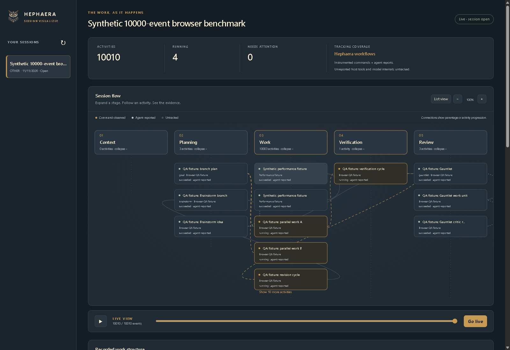

# Hephaera session visualizer

The visualizer is a passive local companion to a Hephaera conversation. Its expandable workflow canvas shows context, planning, work, verification and review, with parallel activity, a timeline, evidence references and replay. It uses Hephaera's existing owl and charcoal/slate/gold/cream palette. The interaction design is inspired by [Transformer Explainer](https://github.com/poloclub/transformer-explainer); this application is independently authored and includes none of its model runtime or source code.

Synthetic benchmark session, captured from native Chromium on Windows:



[Mobile layout](images/session-visualizer/mobile.png) · [Recorded mode structure](images/session-visualizer/structure.png). These screenshots contain synthetic test metadata, not a private conversation recording.

## Startup and session identity

The root agent starts the viewer after resolving paths and reading system memory. Installation and scaffold commands do not start it. Read-only planning does not launch processes or create session state.

From an installed project's root:

```bash
bash .hephaera/commands/session-visualizer.sh start --host codex --label "Movement controls"
```

Use `claude`, `cursor` or `other` for other hosts. The result reports a session UUID, the loopback HTTP URL and browser launch status. `launched-unverified` means the browser process started, not that navigation or rendering passed. Retain the UUID in the conversation across turns and compaction. Reload with `start --session UUID` to reuse it. A different root conversation creates a different session; subagents inherit the parent's UUID and do not start another viewer. One project server can display several sessions.

`start` is a bounded launcher, not a foreground web-server command. It starts the worker detached with no inherited terminal streams, returns `execution: "background"` and its PID, and tells the agent to continue its task immediately. Do not launch the internal `session-visualizer-server.cjs` module directly, wait for the service to exit, or poll its terminal throughout the task. Direct foreground worker invocation is rejected. The normal launcher survives its caller exiting; explicit `stop` still controls the owned service. Cancellation that explicitly kills the service itself remains outside this guarantee.

Set `HEPHAERA_SESSION_ID` explicitly in each shell execution environment. It is a correlation ID, not permission or a global project current-session setting. The command wrapper supplies it and its parent activity to children:

```bash
bash .hephaera/commands/session-visualizer.sh run --session UUID --label "Focused tests" --phase verification -- node --test tests/movement.test.mjs
```

Tool calls often start fresh shells. Starting the visualizer or exporting a variable in one tool call does not supply the identity to the next call. Use `run --session UUID -- ...` for subsequent shell work, including after reload/compaction, or set the identity in the same invocation as each shared command. Keep the UUID in the task's continuation notes and supply it to delegated work. Host-tool actions outside those command boundaries still need concise `emit` reports.

If the canvas stops changing, inspect `status --session UUID` once. `status` reports service execution/PID separately from `activity.total`, `activity.lastRecordedSequence` and `activity.lastRecordedAt`. A healthy server with an unchanged last recorded activity is waiting for observations; it does not establish that the agent is idle or finished. Continue the real task with explicit session context rather than repeatedly restarting or waiting on the server.

The wrapper preserves child arguments, standard streams and exit status. It forwards SIGINT/SIGTERM and records observed cancellation; native Windows console/process signal behavior still depends on the host. Native execution keeps Bubo's existing cancellation ownership.

Automatic shell observation re-enters the caller's Bash executable and preserves its command search order. Failed recorder setup, including unavailable Windows path conversion, leaves the original command running without observation. Help remains available without recorder setup.

On Git Bash/MSYS, the bridge keeps path arguments and environment values intact while crossing Node, then restores the caller's conversion policy before the target runs. A native target receives the same conversions it would receive directly from Bash. Missing or broken optional observer modules leave shared commands and `run` usable without observation.

## Conversational reports and coverage

Shared task/delivery, subagent, test, media and packaging entrypoints emit command observations when an explicit session ID is supplied. The common Bubo host transport observes native execution without changing native DTOs, approval ledgers, ownership hooks or inference timing claims. Admission blocks, process failures, requested cancellation and unknown launch ownership retain distinct metadata outcomes; available exit codes come from the retired child. Other shell work can use `run`. No observer starts the viewer implicitly.

The agent reports significant conversational phases and host tools that the shared commands cannot observe:

```bash
bash .hephaera/commands/session-visualizer.sh emit --session UUID --phase planning --category phase --label "Plan movement controls" --action started --owner "Lead agent" --mode task
# Retain the activityId returned above and use it for subsequent updates.
bash .hephaera/commands/session-visualizer.sh emit --session UUID --activity ACTIVITY_UUID --phase planning --category phase --label "Plan movement controls" --action finished --status succeeded
```

Categories also include `task`, `agent`, `role`, `skill`, `command`, `artifact` and `review`, plus `branch`, `idea`, `goal`, `gauntlet`, `work-unit` and `round` for reported workflow structure. Optional fields include `--parent`, `--task`, `--mode`, `--role`, `--skill`, `--operation`, `--blocker` and repeated `--evidence` project-relative paths. Mode labels describe an already selected mode; they never select Brainstorm, Goal or Gauntlet. Preserve activity identity and classification on updates. Valid statuses are `running`, `waiting`, `blocked`, `succeeded`, `failed`, `cancelled` and `unknown`.

Recorded work structure groups Brainstorm branches/ideas, Goal tasks and Gauntlet work units/rounds using explicit mode reports and parent activity UUIDs. Agent lanes, roles, skills, commands and artifacts can be nested children. A child can inherit its displayed mode from a recorded parent; unrelated activity is never assigned a mode. Expand groups with the mouse or keyboard, load older structure and select entries for details. Missing parents and cyclic reports remain explicit. This view uses the current live/replay reducer and does not inspect workflow files or activate workflows.

The UI identifies command-observed, agent-reported and untracked activity. Unreported host actions, model internals, hidden reasoning and unsupported provider metrics remain untracked. Activity progression edges describe recorded order for an owner, not a dependency or a proof of causation; explicit parent links are distinguished. Quiet periods and disconnections never imply completion. Metadata references do not expose the contents of project files, approvals or private media.

## Prerequisites and private access

Node.js24+ and an existing Chromium browser are required for automatic browser opening. Windows also uses its existing Windows PowerShell to create a protected directory for viewer credentials and browser state. The viewer needs no OpenSSL, certificate issuance or browser certificate/security exception flags. Node uses built-in modules; there is no frontend build, dependency installation, model download, provider call or external asset request. Missing prerequisites leave the underlying work usable and report viewer unavailability.

The server uses HTTP on an ephemeral unprivileged port, bound exclusively to literal IPv4 `127.0.0.1`, while the browser URL uses exactly `my.hephaera.com`. It checks the actual bound socket before publishing runtime metadata. There is no bind-address setting or CLI option: wildcard `0.0.0.0`, LAN addresses, IPv6 and arbitrary hostname aliases are unsupported. Unknown options and invalid browser/connection endpoint pairs are rejected. Requests must arrive through IPv4 loopback with the exact domain/port Host and Origin. Health connects directly to `127.0.0.1` with the domain Host, without DNS, proxies or redirects.

This is deliberately local HTTP and provides no TLS encryption. Authentication, private local files and request-origin restrictions remain in force; the listener must never be exposed as a public server. This policy applies only to the passive session visualizer. [Documentation and CODE previews retain their HTTPS policy](LOCAL_PREVIEW_TLS.md). `HEPHAERA_VISUALIZER_BROWSER` can explicitly select an existing browser executable outside the project; an invalid selection is unavailable, never silently replaced.

Private API requests require a random per-run bearer capability. A private local bootstrap file redirects to the loopback HTTP URL with the capability in its fragment, keeping the bearer value out of the browser's process arguments. The application removes the fragment and retains the capability only in that origin's session storage. CLI status output does not print it. The runtime ownership record, bootstrap files and browser profiles live in `.hephaera/.cache/visualizer/private/`. That directory uses mode0700 on POSIX and a protected Windows DACL granting the current account, SYSTEM and administrators access; it is created with those permissions before credentials are written. Existing settings and session metadata retain the project's filesystem access policy. No certificate or private key is generated for the viewer. Shutdown removes only unchanged bootstrap files created by that service. OS account privileges remain the security boundary, not an OS sandbox. Static routes expose only the enumerated UI assets, never bootstrap files. API routes reject foreign Host/Origin headers, unauthorized clients and all writes.

No raw argv, standard output, environment values, transcripts or reasoning are recorded. Labels are bounded and reject common credential patterns; agents remain responsible for using non-sensitive labels. Evidence is confined to project-relative references without reading file contents.

## Offline hostname and HTTP-only support

Startup opens `http://my.hephaera.com:<port>`. The isolated Chromium browser maps that exact name to `127.0.0.1` and rejects other DNS names within its dedicated profile; proxies are bypassed. This process-scoped rule guarantees offline name resolution without changing system DNS, hosts files or another browser profile. The existing public DNS record remains useful for manual access, but the launcher does not depend on it or its IPv6 answers. Another browser/profile depends on its DNS, policies and authentication.

The exact domain/port is now the accepted Host/Origin; other names and IP aliases are rejected. If an older installation displays `{"error":"Invalid request origin."}` for the domain, update its baseline, stop the owned viewer and restart with the retained session UUID. A version mismatch reports restart-required; it never silently replaces a live service. Keep all history. A fresh authenticated bootstrap is necessary for the new origin.

HTTP-only support satisfies fully offline source/npm/NuGet distribution without certificate import, administrator access, trust setup or an online issuer. The browser's ordinary Not secure label remains and this domain origin is not a secure context. The viewer needs no secure-context-only API. See the [offline transport decision](SESSION_VISUALIZER_HTTPS_PLAN.md), which supersedes the former HTTPS setup plan. ESET exemptions are not prerequisites; startup makes no scanner or trust-store changes.

## Settings and lifecycle

Settings, session records and immutable event files live only at the resolved `.hephaera/.cache/visualizer/`. This is durable host state, ignored by the shared baseline. Do not commit or sweep it as download data.

Create `config.json` there to opt out or suppress browser opening:

```json
{ "enabled": true, "openBrowser": false }
```

`start --no-open` suppresses opening for that invocation. The server can keep recording with no browser. `status --session UUID` inspects recording state; `history --offset 0 --limit 50` lists retained sessions.

```bash
bash .hephaera/commands/session-visualizer.sh end --session UUID
bash .hephaera/commands/session-visualizer.sh stop
# Only after the user explicitly selects an ended session for removal:
bash .hephaera/commands/session-visualizer.sh delete --session UUID
```

Ending is explicit and immutable. Finishing a task or an assistant response does not end the conversation. Stop closes only the owned service and browser handles; it leaves history and browser profile data intact. Managed installations hold a cooperative source read lease while the service runs: stop it before update. Service lifetime is bounded to23hours; expiry stops the viewer without marking any session complete. Restarting with the same session UUID reopens the retained recording with a fresh capability identity.

For upgrades, stop the owned service before updating, then start with the retained session UUID. The client can validate/probe existing version1 HTTPS or version2 literal-HTTP ownership records for explicit shutdown. It never launches a new HTTPS viewer or uses a certificate-exception browser. A still-running old version reports restart-required. New version3 records separate the exact domain origin from the matching literal-IP connection endpoint, with fixed HTTP binding and no certificate/SPKI fields. Event and session history are retained unchanged.

Recording is capped at100,000events or64MiB per session, without automatic deletion. Capacity is displayed as degraded tracking; underlying work continues. Session deletion refuses active sessions, locks, links or unexpected files. A stale writer/launcher lock remains an inspection blocker; never remove it while its owner may be running. Restart can retire a dead server only when its recorded PID is absent and its exact lock ownership agrees. Unknown/live ownership is not killed or discarded.

A published event whose budget update was interrupted is reconciled using those exact retained bytes. The recorder can retire its one exact temporary hard link if publication was interrupted before unlinking it; foreign or additional links block recovery. Other hard-linked metadata and evidence references are rejected. An incomplete temporary file is never presented as an event. Invalid or missing retained metadata reports unavailability rather than inventing history. The current state-transition fence is preserved; viewing metadata grants no native-production or issue/publication authorization.

## Interfaces and verification

The authenticated read-only API provides `GET /api/sessions`, `GET /api/sessions/UUID/snapshot?after=N&limit=N` and `GET /api/sessions/UUID/events?after=N`. The event endpoint streams SSE; fetch clients supply bearer authorization and reconnect after their last applied sequence. Sessions are paginated, snapshots contain at most500events, and slow clients disconnect and resume rather than accumulating unbounded buffers. The browser uses the same pure reducer for live state and replay.

```bash
node --test tests/test-session-visualizer.cjs
node tests/session-visualizer-browser.cjs --root PROJECT_ROOT --session UUID
# Maintainer source checkout: separate synthetic 10000-event native-browser test.
node tests/session-visualizer-browser-performance.cjs
```

The second command uses an existing Chromium through a private inherited DevTools pipe, captures screenshots and checks desktop/mobile interaction, keyboard access, reduced motion, safe label rendering and page-request isolation. It verifies the domain over HTTP, actual IPv4 loopback peer, offline resolver mapping, ordinary insecure-context behavior and absence of certificate/security exceptions. It opens no debugging TCP port. Test profiles and temporary authorization files use the protected private directory; reports/screenshots remain in the project's task cache. It emits labelled test activities and installs nothing. Windows-local evidence alone does not establish Linux/macOS acceptance.

The browser check also adds explicitly labelled agent-reported QA fixtures for parallel branches, a verification-to-revision loop and Goal parent structure, then verifies refresh and stream recovery. The performance command additionally checks synthetic Brainstorm/Gauntlet structure. These fixtures describe the test and are not presented as observed development activity. Interactive Windows startup has been exercised. The three-platform CI matrix runs metadata/service lifecycle tests plus native headless Chromium interaction and the 10000-event benchmark, retaining synthetic reports/screenshots. Treat those checks as verified only after an actual successful run; they do not establish interactive Linux/macOS desktop startup or actual Claude/Cursor host acceptance.

The separate performance command retains its synthetic project under `.local/session-visualizer-browser-performance/`, closes that test session explicitly and copies only the report/screenshots into the maintainer task evidence. It measures a newly rendered update after 10000 events have loaded and requires less than one second. It does not add synthetic history to the conversation session. The list alternative loads older activities in pages and retains focus during live redraws.

The former HTTPS/SPKI and test-relay reports remain historical evidence and are not relabelled as current HTTP acceptance. The retired `--verified-relay` browser diagnostic is no longer supported. Current verification requires direct browser HTTP to the fixed loopback listener; no relay, trust-store change or certificate-error bypass is used.
