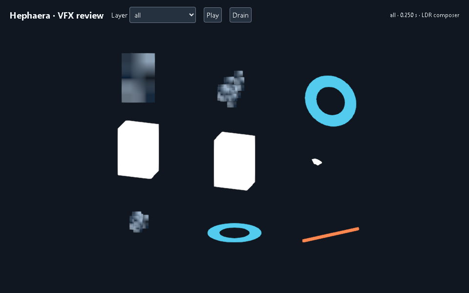
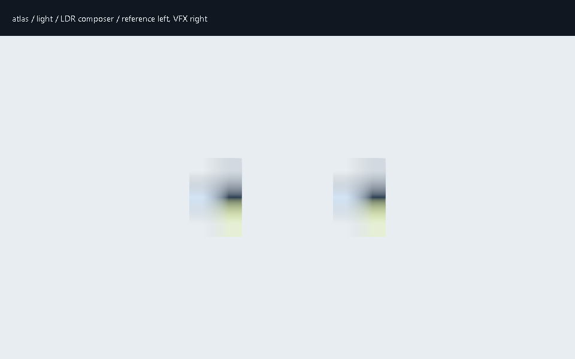

# Three.js VFX

Build an effect as a reusable asset, check how it reads with the real camera, then attach it to a game event. The first production bridge uses the project's selected Three.js renderer, three.quarks and existing LDR postprocessing. It covers sprites and atlases, bursts, rings, static mesh effects, projectile bodies, trails, impacts, ground indicators and beams.

The effect provides presentation. The game supplies real anchors, targets and outcomes. A projectile reaching its visual destination does not cause a hit, and an impact animation cannot award damage.



These deliberately simple fixtures exercise all nine families. They establish renderer behavior; they are not finished game artwork. [Capture identities](images/vfx/captures.json) bind the source and resource bytes used.

## Prepare the resources

Start with [a VFX brief and rights record](VFX_ASSETS.md). Choose finite limits and capture coverage before creating candidates. Keep the project's STYLE and ENGINE; this workflow does not select another visual pipeline.

For an owned or licensed sprite sheet, ordered PNG sequence or procedural mask, use the pinned Bubo preparation path:

```bash
./.hephaera/commands/vfx-assets.sh prepare --manifest PATH_TO_MANIFEST \
  --phase detailed --request inputs/effect/preparation.json
```

Detailed work requires a currently accepted provisional phase. An inexpensive provisional package can use simple reviewed resources first. Each native task/asset/version has one permanent preparation claim, so do not plan a second native preparation in the same version. Create an explicit revision for a changed preparation.

The request uses Bubo's [fixed-input preparation contract](../runtime/bubo/docs/VFX_ASSETS.md). Frame order, selected span, rational frame rate, loop intent, alpha, color interpretation, gutters and all processing bounds are explicit. Video decoding and generated-media receipt admission remain unavailable. Ordinary processing installs nothing.

Preparation reserves the candidate before starting native work. `stage --preparation` finishes that same reservation; it does not grant another attempt. Failed or interrupted work remains spent, including its partial files. Source changes, new folders and revisions cannot reset the original allowance.

## Describe the engine presentation

Native packages describe the resource closure and finite layer capacities. A `hephaera-three-vfx-profile/v1` adds the narrow engine presentation: effect/layer identity, family, burst or rate emission, lifetime, size, speed, linear RGBA, space and bounded tail. It contains data only. It cannot name scripts, shaders, loaders or arbitrary behaviors.

The production profile binds the exact composed package SHA-256 and, when used, the native preparation seal SHA-256. Preserve every prepared resource, its atlas metadata and original layer bindings. Additional original resources need their own exact rights coverage. New layers, bindings and capacities require explicit declarations within the original brief; preparation's default single sprite does not silently become an unlimited particle effect.

| Item | Identity used |
| --- | --- |
| `stage --preparation` | The **host** preparation-receipt file |
| `profile.preparationSha256` | The **native** `preparation.json` seal hash |
| `profile.nativePackageSha256` | Exact composed package bytes |
| Runtime resource binding | Native resource ID/hash plus the actual decoded pixel or geometry digest |

The fixed profile accepts uniform complete atlas grids with explicit interior rectangles. Padding never enlarges the visible sprite. Bitmap billboard `size` is world height; its aspect comes from the frame interior or reviewed image dimensions. Once/repeat playback uses the declared rational timing. A repeated sequence still needs loop-quality review.

The initial trail profile uses one stationary world-space particle, a bounded history and an explicitly supplied path. It accepts a single complete texture cell. Call `resetHistory()` at teleports or discontinuities. Unsupported multi-frame trail layouts fail explicitly.

## Admit actual resources

The host's asset owner must admit the locked libraries and decode resources before runtime construction. The tested set is Three 0.182.0, three.quarks 0.17.1, quarks.core 0.17.1 and postprocessing 6.39.5. Keep one Three/core resolution. Metadata inspection does not prove installed bytes or renderer readiness.

This runtime uses bounded RGBA `Uint8` DataTextures and static, ungrouped BufferGeometry. Texture interpretation is straight alpha with explicit sRGB or linear samples. Geometry admits finite Float32 position/normal/UV arrays and Uint16/Uint32 triangle indices; skins, morphs, instanced source geometry, partial draw ranges and arbitrary material groups are outside this resource profile. Animated actors stay with their model/animation owner.

Each binding needs a separately reviewed source-correspondence report tying the actual PNG or GLB hash to the decoded pixel or geometry digest. A source hash attached to unrelated pixels is insufficient. The runtime checks the actual supplied snapshots, counts and bounds; the host verifies the referenced report and includes it in the current provenance/capture packet. No general PNG/GLB loader, remote resource fetch or decoder installation is hidden in this API.



The left image uses an ordinary Three.js material; the right uses the VFX sprite. Compare transparent edges on both light and dark backgrounds through the selected render route. The diagnostic also checks an opaque sRGB swatch; matching this fixture does not certify another texture or device.

Prepare the composed package, profile and complete visual packet, then finish the reserved phase:

```bash
./.hephaera/commands/vfx-assets.sh stage --manifest PATH_TO_MANIFEST --phase detailed \
  --package inputs/composed/package.json --preparation PATH_TO_HOST_PREPARATION_RECEIPT \
  --production inputs/composed/profile.json --visual captures/effect/visual.json
./.hephaera/commands/vfx-assets.sh verify --manifest PATH_TO_MANIFEST
```

Keep composed files outside the sealed native preparation directory. Adding a file inside that directory invalidates its complete inventory. Data-only staging may happen before renderer libraries are available; it reports rendering unverified and cannot pass visual review without actual current captures.

## Share one scene owner

The reusable modules are under `.engine/threejs/particles/`. The existing particle scaffold copies them to a new host directory without installing packages. If the scene already has a `createThreeQuarksRuntime` owner, pass that same owner into `createThreeVfxRuntime`. Otherwise the service creates that owner. Creating a second owner or BatchedRenderer for the same scene fails.

```javascript
const effects = createThreeVfxRuntime({
  THREE, Quarks, scene, renderer, engineSelection, owner: sceneParticles, budgets
});
const asset = effects.admit({
  package: verifiedPackage, packageBytes, packageSha256,
  preparationSha256, profile, bindings
});
const charge = effects.acquire({
  package: asset, effectId, layerId, id: 'caster-1-charge', ownerId: 'caster-1',
  parent: reviewedHandAnchor, transform: {position: [0, 0, 0]}
});

// Once from the host presentation clock, after updating the real anchors:
effects.update(deltaSeconds);
postprocessing.render(deltaSeconds);

charge.stopEmission({maxTailSeconds: 0.25});
// Cancellation or scene replacement retires the generation immediately:
charge.retire();
```

Use actual declared effect/layer IDs and source anchors. World-space particles retain their emitted world positions; use the declared local-space policy when an emitted body must follow subsequent transforms. Beam endpoints are explicit finite world coordinates. No target, bone or attachment is guessed.

Leases expose `setTransform`, `setEndpoints` for beams, `pause`, `resume`, `stopEmission`, `resetHistory`, `retire` and `stats`. Removed or replaced generations cannot affect a newer lease. Stopping emission keeps a bounded tail; retiring cancels it. Parent removal retires dependent presentation. Active, draining, starter and ambient resources share the same scene limits.

Actual batch arrays have their own bounds. Quarks starts sprite and trail buffers with substantial minimum allocations; a tiny active-particle count does not remove those costs. `maxBufferBytes`, vertices, indices, history, draw, texture and system limits are checked alongside particle capacity, with measured and conservative reserved counters kept separate. These are explicit owned-resource estimates, not a hard GPU/process memory guarantee.

The service has no action scheduler or frame loop. MODEL_TO_ACTION v1 retains its existing behavior. Reusable-package action scheduling is a separate delivery; do not infer an action-v2 bridge from a rendered standalone effect.

## Review the complete result

`vfx-review-scene.mjs` attaches diagnostic playback to caller-owned scene/camera/renderer objects and the existing postprocessing helper. The optional attachment expects `../postprocessing/postprocessing-runtime.mjs` beside the copied particle directory. Scaffold that companion explicitly. It loads no assets and starts no private loop.

Review every family alone and together, complete motion ranges, first/last/repeat frames, transparent edges on dark and light backgrounds, exact anchors, foreground occlusion, bounded tails, pause/cancel, context restoration and disposal. Capture the actual backend, driver, camera, settings, library inventory, resources and source-correspondence reports. Keep private game captures local; separately publishable original fixtures can illustrate the workflow.

Quality and reduced-motion controls reduce emission without granting another burst. Static ring and ground cues retain a declared particle at nonzero quality. Reduced-flash, contrast and color-independent variants still need authored alternatives and actual review; a configuration field is not accessibility acceptance.

Use five comparable baseline/candidate measurements for loading, compilation, steady work and peak concurrency. Investigate median stage regressions above 10%; do not label CPU timing or pixel counts as GPU/device acceptance. Browser rendering does not certify Windows WebView2, Android WebView or Apple WKWebView. Each MAUI target needs its own packaged-game evidence. Unsupported or untested targets remain explicit.

Technical verification, independent production review, human runtime acceptance and asset promotion remain separate decisions. No effect asset or diagnostic capture is copied into a game automatically.
