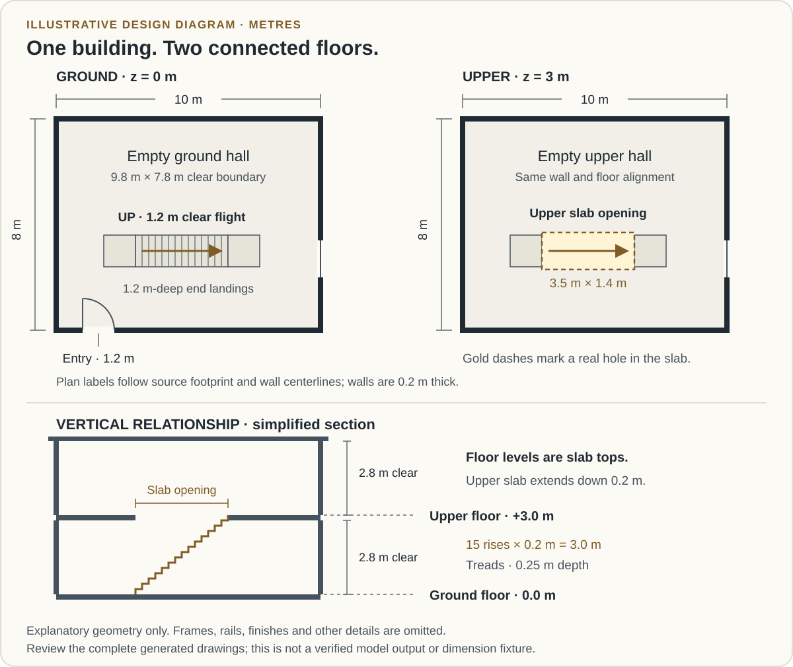
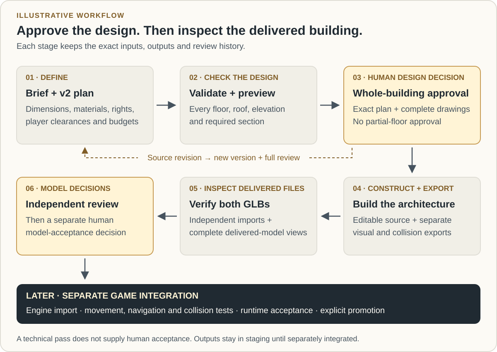

# Build a building from floor plans

Use `FLOOR_PLAN_TO_MODEL` to design a building floor by floor, approve its complete drawings, then construct a detailed, unfurnished model. It supports straight and angled walls, multiple storeys, courtyards and explicit stairs and openings. The result stays in staging for review before a separate game-integration task.

**Availability:** the feature is in the newer `main` source checkout. The published `5.1.0-rc.1` packages predate it; changing that GitHub release's prerelease status does not add newer source to its packages. For a new installation, use the documented [advanced manual installation](install.md#advanced-manual-fallback) until a later package contains the feature. Keep an existing package-managed checkout under its normal update and recovery workflow.

## Start with a small, complete building

This walkthrough uses the existing two-storey hall example. It is deliberately simple enough to inspect: one empty hall on each level, one entrance, one stair and a flat roof. Use it to learn the review process before adding a courtyard or a more complicated room layout.

| Part of the brief | Exercise value |
| --- | --- |
| Plan footprint | 10 m × 8 m on both storeys |
| Finished-floor levels | Ground at 0 m; upper at 3 m |
| Clear storey height | 2.8 m, with a 0.2 m slab below each finished-floor level |
| Walls and rooms | 0.2 m walls; clear hall boundary 9.8 m × 7.8 m, before accounting for the stair and landings |
| Entry and windows | Ground entry 1.2 m wide × 2.2 m high; one east-wall window per floor, 1.4 m wide, sill 0.9 m and head 2.1 m above its floor |
| Stair | 1.2 m wide; 15 rises of 0.2 m, with 0.25 m treads, landings and an explicit upper slab opening |
| Player envelope | Radius 0.3 m, height 1.8 m, maximum step 0.22 m and minimum landing depth 1.2 m |
| Appearance | Project `STYLE.md`; restrained masonry, timber doors, glazing and metal railings in the engineering starting example |

These are exercise dimensions, not building-code advice or defaults for every game. The plan footprint and wall centerlines are explicit source geometry; do not treat the 10 m × 8 m label as a finished exterior-face measurement. Materials and detail still need review against your project's style.

[](../../assets/guides/floor-plan/hall-plans-and-section.svg)

*Illustrative diagram based on the two-storey example's dimensions. It omits construction details and is neither a generated drawing package nor a verified Blender output.*

Select either diagram to open it at full size, especially on a phone.

Give the agent a brief such as:

```text
Use FLOOR_PLAN_TO_MODEL for an unfurnished two-storey hall, following our STYLE.md. Start from the reviewed multi-storey example: a 10 m by 8 m plan footprint, finished floors at 0 m and 3 m, and 2.8 m clear storey heights.

Keep the entrance, east windows, straight stair, landings and upper slab opening explicit. Use the example's player envelope as a starting point; ask me about any mismatch with our game. Agree on materials, detail, tolerances and finite work/output/process budgets before approval.

Show both dimensioned floors, the roof, all four elevations, the principal section and the stair section together. Wait for my approval of that complete design before construction. Deliver the editable model and separate visual/collision exports in staging, with independent review and a separate human model review. Leave game integration for a later task.
```

Selecting this pipeline for the task leaves the project's default pipeline and engine unchanged. New style contracts still default to `PROOF_TO_MODEL`. Ordinary dimension-driven planning needs no image-generation provider or `MEDIA.md`; generating inspiration images is a separately authorized media task.

## Know what each stage should give you

| Stage | What you should receive | What to decide or inspect |
| --- | --- | --- |
| Brief and source | Room list, dimensional v2 plan, rights record and finite budgets | Does it describe the building and player you intend? |
| Validate and preview | Dimensional checks and a complete labeled SVG drawing package | Do the plans, elevations and sections agree? |
| Whole-building review | Your decision bound to that exact plan and every drawing | Approve the complete design or request changes |
| Tool check and build | Prerequisite report, editable source and separate collision construction | Are tools available, and did construction preserve the design? |
| Export and model review | Sealed model package, independent GLB import checks and all required views | Inspect the delivered files; obtain independent review and your separate model decision |
| Later game integration | Target-engine import, movement and collision tests | Evaluate the building in the actual game before runtime acceptance |

The agent keeps stable IDs for floors, rooms, walls, openings and stairs throughout these stages. Reference pictures can guide appearance; the dimensioned source remains authoritative.

[](../../assets/guides/floor-plan/design-to-reviewed-package.svg)

*Illustrative workflow. Approval of the drawings, technical checks, model acceptance and game acceptance are separate decisions. A source revision returns to design review.*

## Prepare the example and inspect its drawings

Ask the agent to use the [prepared example walkthrough](https://github.com/TimothyMeadows/Hephaera/blob/main/examples/floor-plan-to-model/README.md), selecting `multi-storey`. It prepares exact inputs under the task: `plan.json`, `rights.json`, `budget.json`, task-local pipeline selection, the source license and a preparation receipt. The copied engineering source is licensed; the helper preserves that notice rather than claiming that copying makes it your original design.

Before it initializes the building, agree on the finite geometry, output, time, log and memory allowances. The walkthrough's numeric budgets are engineering-example choices. They are not a universal estimate for larger buildings, and a continuation cannot silently widen an approved allowance.

Initialization returns the manifest used for later operations. Validation and preview then produce the checks and drawing locations. Ask to see the full drawing package rather than a chosen attractive sheet. These steps need the pinned Bubo runtime but do not need Blender.

For the hall, follow the route from the exterior door to the lower landing, up the stair and onto the upper floor. Inspect both plans and the stair section together. The upper slab must have a real opening over the flight. A room or stair label alone does not create that opening. The same applies to a future courtyard: its slab and roof voids must be explicit.

## Approve the whole building

Whole-building approval means reviewing one exact set containing every dimensioned floor plan, the roof, all four exterior elevations, the principal section and the section through each stair or other vertical connection. Schedules and details must agree with those drawings.

Use these questions for the hall:

- Do both floors share the intended footprint and levels? Is the 3 m rise consistent with the slabs and 2.8 m clear height?
- Can the declared player reach the upper floor through the entrance, landings, stair and upper opening? Are railings and trim included when checking usable space?
- Are door width, window sill/head heights and wall thicknesses explicit? Do frames preserve the approved apertures?
- Does the roof cover the intended building, and do its materials and edges fit the style?
- Are tolerances, detail and budgets acceptable before construction starts?

If something is unclear, request a dimension or section. For example: “Show the upper slab opening in the stair section and confirm the headroom before I decide.” Approving the ground floor alone, or saying the design looks promising, does not approve the remaining package.

An actual approval is recorded against the current plan and every reviewed drawing. The example supplies no human approval. A later change to either floor, an opening, roof, material or construction detail needs a new version and refreshed whole-design review.

## Check the tools, then inspect the delivered model

Construction, export and model review require an explicitly built pinned Bubo runtime, a supported 64-bit Windows host with committed-memory enforcement, and an explicitly selected existing Blender 4.5 LTS executable. The prerequisite check reports missing tools, unsupported platforms and known path-length problems. It does not install software. Keep project and task paths short on Windows.

After design approval, construction builds the floors, walls, doors/windows, stair, landings, railings, roof, facades and agreed trim/materials. Rooms stay empty. Export produces separate visual and collision GLBs and independently imports both to check that the delivered geometry preserves the approved source.

The two-storey, one-stair hall needs **nine delivered-model views**: two floors, four exterior directions, the roof, the principal section and the stair section. These views come from the imported delivered visual GLB. A screenshot of the source Blender scene cannot replace them.

Review the views alongside the drawings. Check entrances and windows, stair/slab alignment, door pivots, material assignments and whether collision geometry preserves the spaces people should move through. Ask what measured or import evidence supports a claimed pass. A technical pass, independent model review and your human model acceptance are recorded separately.

## Know what is in the handoff

| File or evidence | What it is for |
| --- | --- |
| `building.blend` | Editable building source |
| `visual.glb` | Portable visible geometry |
| `collision.glb` | Separate collision geometry that preserves openings and circulation |
| `building-plan.json`, `semantics.json` | Dimensions, stable source identities, levels, materials, openings and anchors |
| Approved SVG drawings and provenance | The reviewed design and its ancestry |
| `package.json` | Inventory of the sealed payload; its raw hash identifies this exact package |

Import checks, review views and decisions are retained as separate evidence outside the sealed payload. Keep them with the task handoff. All outputs remain in versioned staging outside the game's asset folders.

Measured clearances prepare the building for traversal; actual walking, physics, navigation, door interaction and asset promotion still need separate work in your chosen engine. This workflow does not copy the building into the game.

## Revise or recover without losing the trail

For a design change, ask for a new version linked to the current manifest. For example: “Raise both window sills to 1.1 m in a new version, preserve the previous package, and show the revised full drawings before building.” The agent updates the source and dependent evidence; the earlier approval does not transfer to the new files.

If work stops, ask: “Show the current manifest, the latest failed operation and the prerequisite or design issue it reports.” Then address that issue. Missing Blender needs an explicitly selected existing tool or a separately authorized setup task. A blocked stair needs a design revision. An exceeded allowance needs a reviewed new version with deliberately chosen limits. None is fixed by deleting the task cache or treating an older successful attempt as the current result.

Keep `.hephaera/.cache`, staging, original inputs, rejections and failed attempts so another session can resume accurately. Curved forms, automatic CAD/scanned-plan conversion, furnishings, gameplay and interaction systems remain outside this workflow's current scope. Use the [deeper floor-plan reference](https://github.com/TimothyMeadows/Hephaera/wiki/Floor-Plan-to-Model) for exact commands and records, or return to [art and assets](art-and-assets.md) to choose another workflow.
