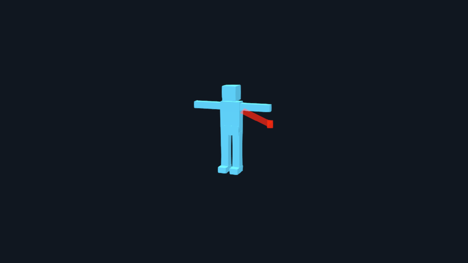
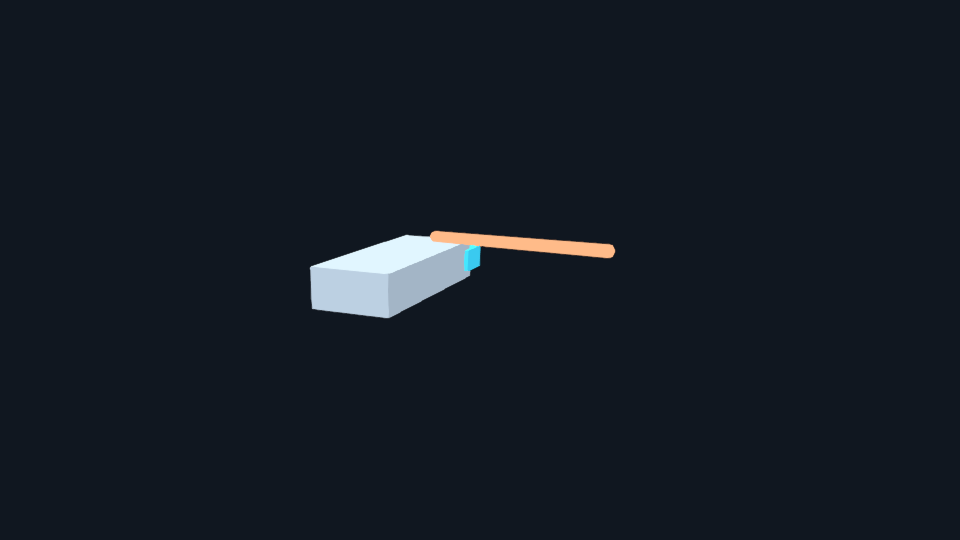

# Game effects and model actions

Make an effect readable on the model, at the moment the player needs it. A casting action might gather light at a hand, release a traveling effect, leave a short trail and finish with an impact. Start with timing and placement, then add detail.

**Availability:** reusable VFX and MODEL_TO_ACTION v2 are in newer source containing the reviewed integration merged as `6b8c8e6ad6080783763f8fe94e982e248af18807`. The current full GitHub release keeps package version `5.1.0-rc.1`; those immutable installers predate these features. Follow [installation](install.md) for packages and managed updates, with deliberate manual source installation last. Merging a guide does not publish a new package.

## Start with a clear request

```text
Plan a casting action for this reviewed model: charge at its actual hand anchor, release on the reviewed clip marker, send a visual projectile toward a fixed point and finish with a readable impact. Keep gameplay targeting and hits separate. Read STYLE and ENGINE, inspect the available clips, rights and tools, and propose finite budgets and review points before making assets.
```

The agent should explain what is ready and what is missing. A model needs real reviewed clips and anchors. A static display mesh, an empty named clip or a guessed hand position cannot stand in for them. Use model-to-animation first when individual motions are missing.

Use `create-game-vfx` for an effect with its own source files and review history. Use `build-model-actions` when effects must follow an ordered sequence of actual clips. These workflows keep the project's primary visual pipeline and engine selection.

## Make the simple version first

Agree on what the player must notice, how long it lasts, where the camera is and what the effect must leave visible. Name the attachment, release event, target policy and important phases. Set finite limits for particles, systems, trails, textures, draw calls, memory, duration, simultaneous actors and candidate/revision attempts.

Start with inexpensive shapes. Review the whole action and the important layers separately before spending time on detailed textures. Check the release pose, direction, relative size, contact alignment, foreground occlusion and final cleanup. If a cue is unclear, revise that version and retain its earlier evidence.

[](../../assets/guides/vfx/caster-trail.png)

This is an actual engineering capture from an original skinned fixture. It shows attachment and travel, not finished game art. One frame cannot prove the complete action or human acceptance; review normal-speed playback and the important boundaries too.

## Build reusable effects

The first production bridge uses the project's Three.js renderer, three.quarks and the bounded LDR/FXAA postprocessing profile. It supports nine families: sprites and atlases, bursts, rings, static mesh effects, projectile bodies, trails, impacts, ground indicators and beams. It does not expose every upstream Quarks feature or switch the renderer.

Owned or licensed PNG sheets, ordered PNG sequences and typed procedural masks can be prepared through Bubo. Frame order, rate, selected span, transparency, color interpretation and processing limits are explicit. The source bytes, decoded resources and tool identities must agree. Video decoding and generated-media receipt admission are unavailable in this path; choosing VFX grants no image-generation allowance or software installation.

The lifecycle command is `vfx-assets.sh`: inspect prerequisites, initialize an asset/version, stage provisional work, record its independent review, then prepare and stage detail. It stores durable state under the task cache and keeps candidates outside game asset folders. Failed attempts count, and a new folder or version does not reset the allowance. The [technical asset guide](https://github.com/TimothyMeadows/Hephaera/blob/main/docs/VFX_ASSETS.md) covers exact commands and records.

## Put the effect on the real action

V2 recipes reference exact reviewed effect packages alongside clips, markers and anchors. The native export contains the composed clip, resolved cue times and complete effect dependencies. The host loads that exact export; it does not guess marker timing or replace a missing effect.

One Scene scheduler advances the action actors, ambient effects and draining tails from one presentation clock. The existing renderer/composer still renders once. Do not add a second update loop for particles. Completing the motion releases its rig before declared tails finish; cancellation, replacement and disposal retire the affected generation immediately.

A fixed target is copied when the action starts. A continuously aimed beam is a separate explicit policy: the game supplies fresh, bounded endpoint updates. Rehearsal may display a planned impact; a real game supplies its own confirmed contact position and normal. A visual projectile arriving at a point does not cause damage or establish a hit.

[](../../assets/guides/vfx/rigid-beam.png)

This actual rigid-fixture capture uses an explicit beam endpoint, without adding a fake skeleton. Its complete travel and input-failure behavior require playback and technical evidence beyond this frame.

Existing v1 packages keep their original primitive cues and behavior. V2 supports reviewed skinned, articulated and rigid motion packages through the Three.js bridge. Mixed `mechanical-assembly` actions and other-engine bridges are outside the current path; the mechanical animation handoff remains a separate capability.

## Review readability, cost and alternatives

Watch complete normal-speed actions with the intended camera. Inspect isolated layers, first/last/repeat frames, transparent edges on dark and light backgrounds, overlap with the model and UI, exact release, tails and cleanup. Test two actors with ambient effects, pause, cancellation, repeated starts, scene exit and unavailable inputs.

Request authored reduced-motion and reduced-flash alternatives, plus contrast and color-independent cues. A lower particle count is useful for cost, but it does not by itself preserve an essential warning or make an effect accessible. Review those alternatives as actual outputs; the engineering screenshots above do not claim that review is complete.

Measure loading and compilation separately from steady playback and peak concurrency. Compare at least five comparable baseline/candidate runs and investigate median-stage regressions above 10%. Label CPU submission or software-renderer measurements honestly. A desktop browser result does not certify a physical GPU or a packaged game.

MAUI packages still target Windows, Mac Catalyst, Android and iOS. Each needs actual packaged-game checks for loading, lifecycle/context recovery, color/transparency, performance and cleanup. Linux/TV, WebGPU, ray/path tracing and other-engine VFX bridges are not added by this workflow. Missing tools or an unsupported target require direction; there is no silent installation or fallback.

## Keep acceptance separate from delivery

Technical checks establish structure and exercised behavior. Independent review examines the current evidence. A human then makes the separate runtime acceptance decision for the exact result. Native action promotion is an explicit later operation; staging an effect or binding a receiving report does not copy it into the game or record acceptance.

Keep source files, rights, failed attempts, reviews, captures and current hashes together. A changed model, clip, effect, driver, library, camera or setting invalidates affected evidence. Ask the agent to explain what changed and what must be reviewed again.

For exact schemas and receiving rules, read the [VFX/action reference](https://github.com/TimothyMeadows/Hephaera/wiki/VFX-and-Action-v2), [action technical guide](https://github.com/TimothyMeadows/Hephaera/blob/main/docs/MODEL_TO_ACTION.md) and [source walkthrough](https://github.com/TimothyMeadows/Hephaera/blob/main/examples/action-vfx/README.md).
