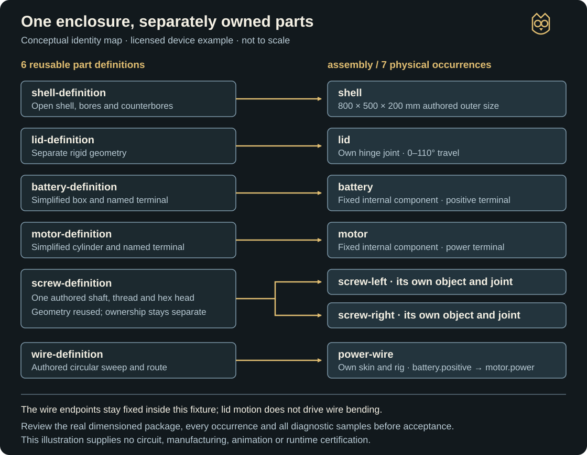
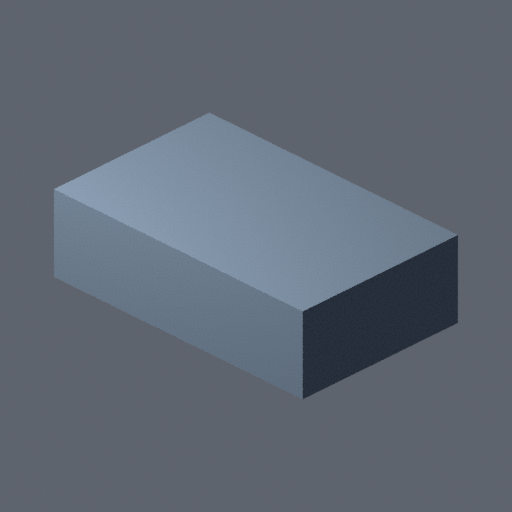
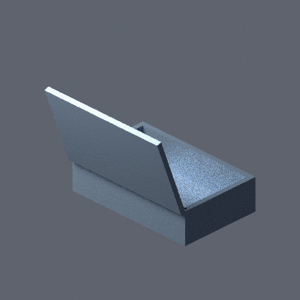

# Build an object from schematics

Use `SCHEMATIC_TO_MODEL` when an object needs real parts: a lid that opens around its hinge, screws that move separately, or wires with their own geometry and attachments. Design and approve the complete object, build its part definitions, then assemble the individual occurrences. The delivered model looks assembled while its components remain separately addressable.

**Availability:** included in `5.2.0`. Use [installation and managed updates](install.md), then explicitly prepare the recorded native runtime and existing Blender. Keep design approval, complete model review and runtime acceptance separate.

Open any illustration at full size to inspect labels on a smaller screen.

## Worked example: an opening electronic enclosure

This walkthrough uses the existing licensed `device` example: an open-topped shell, hinged lid, battery and motor shapes, two threaded fasteners, and one wire. It is a deliberately minimal engineering fixture. The dimensions are authored demonstration choices, rather than measurements recovered from a photograph or a production electronics design.

Start with a request like this:

```text
Use SCHEMATIC_TO_MODEL to walk me through the licensed opening-device example. Follow this project's STYLE.md and retain the example's source and license records.

Show me its dimensions, every part and physical occurrence, internal section, electrical connection, hinge travel, screw pitch and wire policy. Agree on finite process and output budgets before construction. Present the exact complete design package for my approval before building parts.

Deliver editable source, an assembled rest GLB and separate diagnostic-motion evidence in staging. Keep model acceptance, finished animation and game integration as later decisions.
```

Selecting this pipeline for one task preserves your project's default visual pipeline, engine and separate audio, music and voice workflows. Reference images can guide appearance; they do not supply dimensions automatically. Use [floor plans to buildings](floor-plan-to-model.md) for architecture.

### Understand the dimensions and inventory

The structured design uses metres with Z up. These are the same dimensions expressed in millimetres for reading:

| Definition | Physical occurrence IDs | Authored example detail |
| --- | --- | --- |
| `shell-definition` | `shell` | 800 × 500 × 200 mm; open cavity with 30 mm side walls and a 20 mm floor; real fastener bores and counterbores. |
| `lid-definition` | `lid` | 800 × 500 × 30 mm; closed rest position starts at Z = 200 mm; hinge travel 0–110°. |
| `battery-definition` | `battery` | Simplified 100 × 100 × 50 mm box with a named power terminal. |
| `motor-definition` | `motor` | Simplified cylinder, 100 mm diameter × 80 mm high, with its own power terminal. |
| `screw-definition` | `screw-left`, `screw-right` | One authored shaft/thread/hex-head definition; two occurrences, each with a separate 0–720° screw joint and 2 mm/revolution pitch. |
| `wire-definition` | `power-wire` | 120 mm rest route with a 1.5 mm circular-section radius; its own skin and deformation rig. |

There are **six definitions and seven physical occurrences**. Sharing the screw geometry does not merge the two screws. Each keeps its own object, identity, transform and joint. The wire connects `battery.positive` to `motor.power`. Both endpoints stay on fixed internal components in this example; it does not demonstrate a wire bending with the opening lid. Electrical relationships describe connectivity, rather than simulate a working circuit.

[](../../assets/guides/schematic/part-identities.svg)

*Explanatory diagram authored for this guide. It shows definition reuse and component ownership; it is not a dimensioned schematic, generated model or approval artifact.*

For an original device, replace this brief with its actual dimensions, materials, terminals, interfaces and inspection requirements. Declare missing systems and simplifications before approval. The fixture has no complete circuit, commercial hinge hardware or manufactured-product certification, and its steel material is a diagnostic choice rather than an accepted interpretation of your project's style.

## 1. Prepare inputs and check availability

The [example preparer](https://github.com/TimothyMeadows/Hephaera/tree/main/examples/schematic-to-model) copies the pinned device design into a fresh task version. It retains the MIT notice and source identity, binds the current style, and records your explicit allowances. Its output includes `design.json`, licensed `rights.json`, `budget.json`, task selection and a preparation receipt. Preparation creates no approval or model.

Choose finite time, memory, log, geometry, drawing, triangle, motion-sample and output allowances for the actual task. The documented example allowances are starting choices to review, rather than universal defaults.

Design validation and previews need no Blender. Native construction requires the explicitly built matching Bubo runtime, an explicitly selected existing Blender 4.5 LTS installation and currently supported 64-bit Windows committed-memory enforcement. Once `init` has created the manifest, ask the agent to run `doctor` and report any missing prerequisite before construction. Pipeline selection installs nothing. Ordinary procedural design needs no media provider or model download; generated reference images are a separate request.

## 2. Review and approve the complete design

After `init`, `validate` checks dimensions and relationships. `preview` produces the complete schematic package. Review these together:

- All six dimensioned orthographic views, including the closed lid and enclosure height.
- The declared internal section, each part sheet, exploded assembly and hierarchical bill of materials (BOM).
- The battery-to-motor connection, named terminals and the owned wire route.
- Hinge axis and 0–110° limit, both screw joints and their 2 mm/revolution pitch.
- Assembly and flexible-rig policy sheets, including contact regions, clearances, sampling, tolerances, materials and simplifications.

Check that the BOM contains two screws while the definition list contains one screw definition. Ask how the chosen sampling and precision will be verified in the exported files. A validator pass or a convincing exterior view cannot answer those review questions alone.

The agent waits for your decision on the **exact complete package** and records that decision as `whole-assembly-design`. Approving only the lid, one view or a parts list does not approve construction. A revised dimension, interface, motion policy or drawing changes the package and needs refreshed approval.

## 3. Build parts, assemble and check movement

The following stages have different expected outputs:

| Stage | What you should receive or inspect |
| --- | --- |
| `build-parts` | Independently built and reopened part prototypes, measured dimensions/materials, and the exact definition-to-occurrence inventory. |
| `assemble` | An editable assembled source with every occurrence, opening, interface and pivot preserved. The lid and screws remain individually addressable. |
| `prove-motion` | Separate sampled diagnostics for the lid and each screw driver, including rest, endpoints and intermediate poses; owned wire geometry and attachment checks. |
| `export` | A sealed rest package plus separately labeled diagnostic motion, with actual portable-byte and fresh re-import verification. |
| `review` | Six orthographic model views, two exterior angles, every declared internal section, an exploded view and every diagnostic sample. |

Construction uses Bubo's fixed audited schematic bundle on declared local working copies. Missing parts, fused components, broken interfaces, unapproved interference or excessive wire deformation fail explicitly. There is no silent proxy, remeshing or alternate-pipeline fallback.

Diagnostic motion checks the declared sampled articulation. It does not establish continuous collision, arbitrary combinations of independent drivers, manufacturing safety, electrical behavior or general physics. Diagnostic timing also defines no production animation speed.

## 4. Inspect real output at a useful scale

These two images come from an existing synthetic QA run of the minimal device fixture. They show what a simple review render can look like; the worked guide has not created a newly accepted production asset.

[](../../assets/guides/qa/device-rest.png)

*Actual QA fixture, closed rest view. Internal parts and fastener movement are hidden by this exterior view; the image alone cannot establish their presence or quality.*

[](../../assets/guides/qa/device-open.png)

*Actual QA fixture, open-lid diagnostic sample. This is one sampled pose, not a finished animation. The lid and camera obscure internal details; wire, terminal attachments, threads and hidden screw travel require close or isolated inspection of the bound source or GLB.*

Use the complete delivered package and view inventory for the actual review:

| Delivery | Purpose |
| --- | --- |
| `assembly.blend` | Editable assembled source retaining component identities. |
| `assembly.glb` | Canonical assembled rest model, without animation. |
| `assembly-design.json`, `assembly-metadata.json`, `bom.json` | Approved design, component relationships and hierarchical inventory. |
| Approved drawings and provenance | Trace the delivered geometry to the reviewed inputs and construction. |
| `diagnostic-motion/` | Separate editable/portable articulation diagnostics and sampled-motion metadata. |

Review every occurrence, including small or hidden parts. Confirm that the lid turns around the approved hinge, each screw moves independently around its own axis, openings survive export, and the wire remains attached to its named terminals. Check the actual rest and diagnostic exports against their technical certificates. Metadata and component counts alone do not prove that the geometry matches.

After technical verification, an independent reviewer examines the exact current package and complete views. Your separate `human-model` decision records model acceptance. Synthetic QA decisions and automated fixture checks do not supply that judgment. Files remain in non-runtime staging; this workflow has no promotion operation and copies no asset into a game.

## 5. Resume, revise or add animation

Ask for `status` before continuing work. It reports the current design, parts, assembly, export and review state, including stale or failed stages. Durable state stays under `.hephaera/.cache/tasks/<task>/schematic-to-model/<asset>/<version>/`; originals and attempted outputs stay under `.art-staging/tasks/<task>/schematic-to-model/<asset>/<version>/`.

| Situation | Safe next step |
| --- | --- |
| A tool, platform limit or necessary path is unavailable | Keep the result and resolve that prerequisite explicitly before native work. |
| A clearance, attachment, precision or budget check fails | Inspect the actual measured failure. Correct the design or explicitly revise the requirement; preserve the failed version. |
| You change the lid size, screw pitch, wire route or immutable policy | Create a new version with its parent manifest, regenerate the package and obtain refreshed affected reviews. |
| An attempt is interrupted or the latest result is rejected | Retain its evidence; use status to resume through a valid new attempt. Do not silently select an older success. |
| A later handoff becomes stale | Re-establish the current source and reviews before requesting a new descriptor. |

Keep `.hephaera/.cache`, source records, failed attempts and prior decisions. Do not delete history, change expected hashes, increase approved limits silently or relabel old approvals to force a retry. A revised numerical requirement does not make the original failed requirement pass.

For later finished animation, a current independent model review can issue the `mechanical-assembly` handoff. Explicitly select [MODEL_TO_ANIMATION](https://github.com/TimothyMeadows/Hephaera/blob/main/.styles/.workflows/model-to-animation/WORKFLOW.md) with that exact descriptor and rest GLB. It preserves the reviewed rigid occurrences and existing flexible rigs. It grants no new rig or retargeting authority, and the diagnostic clips do not become finished clips automatically. Motion review, human runtime acceptance, engine behavior and explicit promotion remain later steps.

Read the [detailed wiki source](https://github.com/TimothyMeadows/Hephaera/blob/main/wiki/Schematic-to-Model.md) for the worked command sequence, review records and recovery reference, or the [technical contract](https://github.com/TimothyMeadows/Hephaera/blob/main/docs/SCHEMATIC_TO_MODEL.md) for exact schemas and limits. The wiki source is maintained in this repository; a source merge does not publish GitHub's separate wiki.
