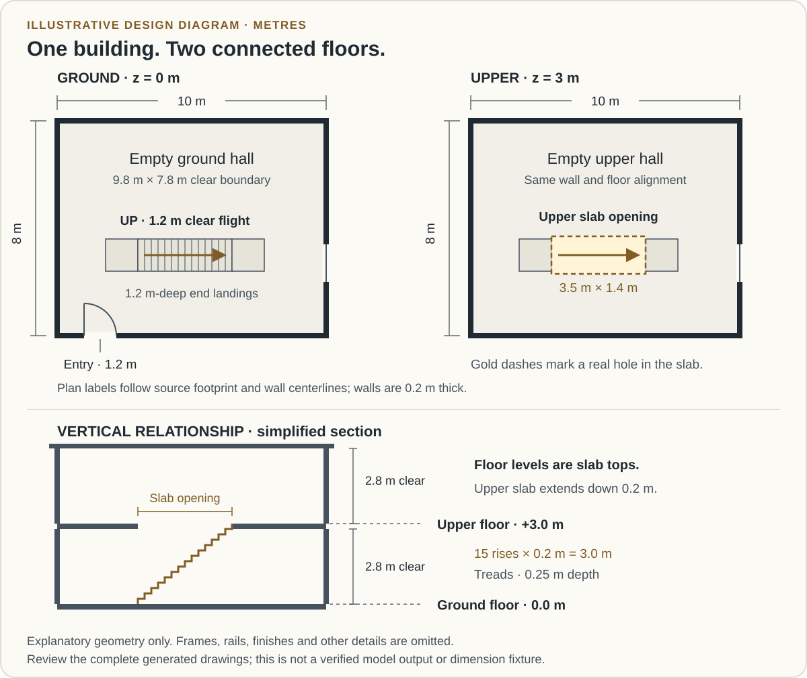
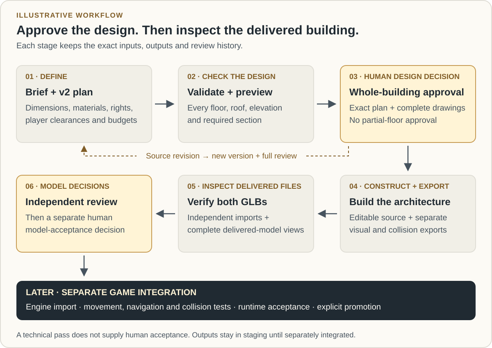

# Floor plan to model

`FLOOR_PLAN_TO_MODEL` turns one approved, dimensioned architectural design into detailed unfurnished building models. It supports straight and angled walls, multiple storeys, courtyards, explicit openings and vertical connections. It produces game/environment assets with editable source and portable exports.

Use the [practical guide](https://hephaera.com/docs/floor-plan-to-model/) for the everyday workflow, the [technical reference](https://github.com/TimothyMeadows/Hephaera/blob/main/docs/FLOOR_PLAN_TO_MODEL.md) for flags/records, and the [example walkthrough](https://github.com/TimothyMeadows/Hephaera/blob/main/examples/floor-plan-to-model/README.md) for reproducible prepared inputs. Included in `5.2.0`. Use the normal [package installation and managed-update workflow](Installation-and-Layout), then explicitly initialize/build the recorded native runtime. Installing a new launcher alone does not update an existing pinned host.

## Worked example: an empty two-storey hall

Start with `multi-storey`, one of the three licensed native examples. Its small room layout makes errors in levels, stair openings and delivered geometry easier to find. The other cases are a single-storey studio and an angled courtyard; they use the same stages with different designs.

The hall's footprint is 10 m × 8 m on both levels. Its finished floors are at 0 m and 3 m, each with 2.8 m clear height and a 0.2 m slab below the floor level. The wall centerlines follow the footprint edges; 0.2 m walls leave a 9.8 m × 7.8 m clear room boundary before stair/landing occupancy. The footprint label is not a finished exterior-face dimension. One ground-floor exterior entry is 1.2 m wide with a 2.2 m head. Each east window is 1.4 m wide, with a 0.9 m sill and 2.1 m head relative to its floor.

One straight stair rises 3 m in 15 risers of 0.2 m. It has a 1.2 m width, 0.25 m tread depth, 1.2 m-deep end landings and an explicitly declared 3.5 m × 1.4 m upper slab opening. Its design headroom is 2.2 m. The player envelope is radius 0.3 m, height 1.8 m, maximum step 0.22 m and minimum landing depth 1.2 m. These values define the engineering exercise; they are neither universal game defaults nor building-code certification.



*Illustrative diagram based on the native example. It omits construction details and does not replace the generated, complete dimensioned drawings or actual Blender evidence.*

Use the project's `STYLE.md` to review the example's restrained masonry, timber, glazing and metal materials. Keep rooms unfurnished. The [example brief](https://github.com/TimothyMeadows/Hephaera/blob/main/examples/floor-plan-to-model/brief.md) is a reusable request, not a recorded approval of its design or art treatment.

### Prepare and preview

Run the following in an installed host project's root after the ordinary task exists and the pinned runtime has been initialized/built as described below. These are Bash commands; use Git Bash on Windows. A maintainer source checkout alone is not an alternate supported host layout.

```bash
node .hephaera/examples/floor-plan-to-model/prepare-example.cjs \
  --root . --case multi-storey --task fp --asset hall --version v1 \
  --geometry-checks 4000000 --timeout-seconds 600 \
  --max-log-bytes 16777216 --max-private-bytes 8589934592

bash .hephaera/commands/floor-plan-to-model.sh init \
  --task fp --asset hall --version v1 \
  --plan .hephaera/.cache/tasks/fp/example-inputs/hall/v1/plan.json \
  --rights .hephaera/.cache/tasks/fp/example-inputs/hall/v1/rights.json \
  --budget .hephaera/.cache/tasks/fp/example-inputs/hall/v1/budget.json \
  --selection .hephaera/.cache/tasks/fp/example-inputs/hall/v1/selection.json

manifest=.hephaera/.cache/tasks/fp/floor-plan-to-model/hall/v1/manifest.json
bash .hephaera/commands/floor-plan-to-model.sh validate --manifest "$manifest"
bash .hephaera/commands/floor-plan-to-model.sh preview --manifest "$manifest"
bash .hephaera/commands/floor-plan-to-model.sh status --manifest "$manifest"
```

The preparer preserves the source license and creates exact plan, rights, budget and task-scoped selection records plus a preparation receipt. It changes only the style hash and explicitly chosen geometry-check allowance in the copied plan. The 4,000,000 checks, 600 seconds, 16 MiB log and 8 GiB committed-memory cap are deliberate example allowances selected before approval; inspect them for your machine and task. An existing destination is preserved rather than overwritten.

Use the actual manifest returned by `init`; the variable shows the expected path for these IDs. Read the returned drawing paths. A successful preview means there is a complete drawing package to inspect. It creates no human approval, model or engine asset. Follow the entrance-to-upper-floor route across both plans and the stair section. Check that the real upper slab opening covers the flight and that clearances include the player body, railings and finishes.

### Move from drawings to a delivered package



*Illustrative workflow. Each review binds the exact current artifacts. A source revision returns to whole-design review; no technical pass supplies a person's acceptance.*

After reviewing the complete drawings, preserve the actual human decision using the review fields described below. The path in this command is a placeholder for that real record; this walkthrough does not create an approved receipt:

```bash
bash .hephaera/commands/floor-plan-to-model.sh record \
  --manifest "$manifest" --kind whole-building-design \
  --reviewer REVIEWER_ID --evidence .hephaera/.cache/tasks/fp/reviews/design-v1.json
```

On a supported 64-bit Windows host, replace the executable placeholder with the absolute path of an existing Blender 4.5 LTS installation. Inspect `doctor` before proceeding:

```bash
blender_executable='C:/path/to/Blender-4.5/blender.exe'
bash .hephaera/commands/floor-plan-to-model.sh doctor --manifest "$manifest" --blender "$blender_executable"
bash .hephaera/commands/floor-plan-to-model.sh build --manifest "$manifest" --blender "$blender_executable"
bash .hephaera/commands/floor-plan-to-model.sh export --manifest "$manifest" --blender "$blender_executable" --author MODEL_AUTHOR_ID
bash .hephaera/commands/floor-plan-to-model.sh review --manifest "$manifest" --blender "$blender_executable"
bash .hephaera/commands/floor-plan-to-model.sh status --manifest "$manifest"
```

Expect editable architectural source, separate visual/collision GLBs, independent import reports and nine delivered-model views: two floor views, four cardinal exteriors, roof, principal section and stair section. Inspect the imported result against the drawings, then obtain independent model review and separate human model acceptance. The source example, CLI success and diagnostic renders supply none of those human decisions or target-engine acceptance.

## Select the production method

Read `STYLE.md`, resolve `build-floor-plan-models` and require compatibility. Resolve `FLOOR_PLAN_TO_MODEL` as the primary or as a current task's explicit override. Task selection binds the current STYLE hash and does not rewrite the project contract. `PROOF_TO_MODEL` remains the default.

```bash
bash .hephaera/commands/resolve-skill.sh build-floor-plan-models
bash .hephaera/commands/resolve-art-pipeline.sh --override FLOOR_PLAN_TO_MODEL --json \
  --evidence .hephaera/.cache/tasks/fp/floor-selection.json
```

The pipeline is engine-agnostic and preserves `ENGINE.md`. All-procedural plans need no media provider or `MEDIA.md`. Generated inspiration follows its separately authorized media workflow. Reference pictures do not establish trustworthy dimensions automatically. Configured external asset libraries retain their [read-only search/copy rules](Visual-Pipelines#optional-external-asset-libraries).

## Execution authority and prerequisites

Hephaera owns policy, rights, selection, approvals and provenance. Bubo owns native contracts, dimensional validation, drawings, geometry, audited scripts, export and re-import verification. Use the current [Bubo lock](https://github.com/TimothyMeadows/Hephaera/blob/main/runtime/bubo.lock.json), its actual gitlink and an explicit clean build. Admission requires API 2, matching resources/build, and the complete nine-operation `architectural-export` capability with modeling/export available. A declared workflow or an initialized source checkout alone is not executable readiness.

```bash
bash .hephaera/commands/initialize-bubo-runtime.sh
bash .hephaera/commands/build-bubo-runtime.sh
```

These commands require existing source-transport tools and the .NET 10 SDK. Modeling currently requires supported 64-bit Windows committed-memory enforcement and an explicitly selected existing Blender 4.5 LTS executable. Pure initialization, validation and preview work without Blender. No SDK, Blender, model, driver, provider, license acceptance or engine host is installed automatically.

Keep project/task/asset/version paths short on Windows. Known fixed source, output, partial-report and temporary paths must fit Blender's Windows file/directory limits before native modeling starts. `doctor` reports path prerequisites as unavailable and can withhold a selected tool without claiming it was probed. Raw native dispatch evidence and the host diagnostic remain separate. A necessary fixed-path pass does not certify every Blender/SDK internal path; actual execution and output checks remain required.

## Author the complete dimensional source

Use construction-capable `bubo-building-plan/v2`; v1 remains design-only. The installed resource directory is `.hephaera/runtime/bubo/resources/floor-plan-to-model/`. Its v2 schema, `CONSTRUCTION.md` and `EXPORT.md` are authoritative. The [technical reference](https://github.com/TimothyMeadows/Hephaera/blob/main/docs/FLOOR_PLAN_TO_MODEL.md#design-source) links the reviewed native snapshot; runtime admission always uses the current local lock.

Before drawing approval, capture:

- Purpose, floors, footprint, architectural style and materials.
- Stable floors/rooms/walls/openings/stair/roof identities and one shared datum.
- Explicit room adjacency, exterior entry, required room routes, stairs, landings and slab/courtyard voids.
- Player radius/height/step/landing envelope, clearances and numerical tolerances.
- Construction detail profile and finite work, mesh/triangle, output, time, log and memory allowances.

All source positions use XY metres and absolute Z up. Floor elevation is the finished-floor top; slabs extend downward. Rooms describe clear finished-face space. Wall centerlines/thicknesses and opening offsets/sills/heads are explicit. An opening remains its reviewed size after frames and trim. A courtyard label does not cut a slab or roof; the actual voids/planes must be declared.

Stairs connect consecutive storeys through explicit rooms, landings and the required slab opening. Native validation checks actual dimensions, overlapping solids, headroom, support heights and the complete player body across transitions. Materials and profile dimensions cannot be guessed, clipped or changed to hide a conflict. JSON shape conformance and graph connectivity alone cannot establish built geometry or clearance.

## Bind source rights and budgets

`init` needs an exact plan plus two explicit host records:

| Record | Required content |
| --- | --- |
| `hephaera-floor-plan-rights/v1` | Exact `planSha256`, `owned`/`licensed` status, actual `rightsHolder`, `scope: floor-plan-to-model`, `evidence` and `referenceInputs` arrays |
| `hephaera-floor-plan-budget/v1` | Explicit safe-integer `timeoutSeconds`, `maxLogBytes` and `maxPrivateBytes` |

Permission evidence entries have local `path` and exact `sha256`. Each optional reference input has its own path/hash/status/holder/evidence. Licensed plans and references require permission/license evidence; a copied source is not automatically owned. Keep source notices. The example preparer preserves the Bubo license and records its copied engineering plan as licensed.

Hephaera captures exact rights, references, budget, style/selection and runtime identities in immutable per-version policy. It does not adopt a changed file's hash automatically. Process ceilings supplement the source's dimensional/geometry/export allowances. Select adequate finite values before approval; a later operation cannot silently widen them or replenish a prior allowance.

## Commands and state

Run the public wrapper from the host root. `--root PROJECT` explicitly selects that same host when needed. Returned paths are authoritative.

| Operation | Arguments beyond the root | Result or gate |
| --- | --- | --- |
| `init` | `--task --asset --version --plan --rights --budget`; optional `--selection --parent-manifest` | Preserves exact input/version ancestry and returns the manifest |
| `validate` | `--manifest` | Current structural and dimensional validation |
| `preview` | `--manifest` | Complete labeled, dimensioned SVG package |
| `doctor` | `--manifest`; optional `--blender` | Tool/platform/path inspection with explicit unavailable scopes |
| `record` | `--manifest --kind --reviewer --evidence` | Records an actual current whole-design, independent-model or human-model decision |
| `build` | `--manifest --blender` | Detailed source and collision construction from an approved v2 design |
| `export` | `--manifest --blender --author` | Sealed portable package and independent visual/collision imports |
| `review` | `--manifest --blender` | Complete delivered-model view set |
| `status` | `--manifest` | Current state, failures and separate acceptance gates |

There are no actor/recipe/toolchain, setup, generation, promotion or engine-integration operations. Runtime IDs, execution context and output roots are protected host fields. Explicit Blender paths are absolute and cannot overlap source/state/staging. Model-consuming continuation retains the current construction's exact tool; pure design does not require an old tool that is no longer available.

The canonical manifest is `.hephaera/.cache/tasks/<task>/floor-plan-to-model/<asset>/<version>/manifest.json`. The example helper keeps prepared sources in a separate task-local `example-inputs/` directory. Immutable native attempts stay under task-scoped `.art-staging/`. These are durable/versioned inputs and evidence, not disposable downloads. No command copies an output into a game.

## Approve every drawing together

Design floors separately, then review one exact package containing:

1. Every dimensioned floor plan in elevation order.
2. The complete roof plan and all four exterior elevations.
3. A principal vertical section, plus the section through every stair/connector.
4. Room/wall/opening/stair schedules, labels, clearances, construction details and their shared levels/dimensions.

Bind actual human approval to the plan SHA, complete drawing-hash dictionary and current design fingerprint. A single floor, image or metadata receipt cannot approve the building. Any source/detail revision invalidates whole-design approval and dependent models.

For the hall, review the plans side by side with the stair section. Ask whether the 3 m floor rise, 2.8 m clear height, slab thickness, opening and landings describe the same construction. Check the entry-to-stair route and each window's floor-relative sill/head. Request a missing dimension or section before deciding. “Show the upper slab opening and its headroom in section” is a useful revision request; approval of only the ground floor is incomplete.

Whole-design evidence uses `bubo-floor-plan-review/v1` and includes kind/decision/human/reviewer/reason, asset/version, plan SHA, design fingerprint and `reviewedArtifacts`. A command records submitted evidence; a successful technical check cannot supply a person's acceptance. The documented examples create no approved human record.

## Review the delivered building

Construction preserves per-floor hierarchy, semantic identities, explicit pivots and separate visual/collision geometry. Native build produces actual floors, ceilings, shared walls, doors/windows, stairs/landings/railings, roofs, facades, trim and materials according to the approved profile. Rooms remain empty.

Export retains editable source and independently imports both delivered GLBs in clean Blender processes. Verification compares actual world-space triangles, winding, material assignments, hierarchy, openings and pivots against the immutable native scene within the approved tolerances. Matching object counts or bounds alone is insufficient. No tolerance increase or ideal-geometry repair hides a mismatch.

Render the imported delivered visual GLB for all required views: every floor, four cardinal exteriors, roof, principal section and each stair section. The required count is `storeys + stairs + 6`, giving 7/9/7 views for the three documented engineering cases. Source `.blend` screenshots cannot substitute for delivered-model evidence.

Independent and human model decisions bind the raw package SHA, both verification SHAs, complete view-index SHA and exact artifact inventory. `independent-model` uses `human:false` and a reviewer distinct from the sealed author. `human-model` uses `human:true` and the current approved independent-review hash. Preserve rejections; a stale or rejected decision cannot authorize acceptance.

## Package and later engine work

The sealed package contains editable `building.blend`, separate `visual.glb`/`collision.glb`, the v2 plan, semantic metadata, approved drawings and provenance. `package.json` inventories the payload except itself; its raw hash identifies the package externally. Producer/verification/view reports and submitted decisions remain outside that sealed inventory.

| Handoff item | Practical inspection |
| --- | --- |
| `building.blend` | Editable, per-floor source hierarchy and actual door pivots |
| `visual.glb` | Delivered meshes/materials and the geometry shown in the complete review views |
| `collision.glb` | Separate entrances, room circulation, stairwell and declared door collision |
| `building-plan.json` | Exact v2 dimensional source associated with the design approval |
| `semantics.json` | Floor levels, stable IDs, materials, openings, hierarchy and anchors |
| Drawings and provenance | Complete reviewed design and source/construction ancestry |
| External reports and decisions | Current import verification, full view index, independent review and human model decision bound to the sealed package |

Source uses Z-up metres; GLB uses Y-up metres with the declared exact conversion. Semantic metadata preserves the source plan, floor elevations, material IDs, hierarchy, openings and anchors. Door geometry is closed at zero; dynamic leaf collision and explicitly final-open route evidence remain distinguishable. Collision proxies preserve rooms, entrances and stairwells rather than replacing the building with one convex hull.

Clearance evidence describes measured constructed geometry and its verified export preservation. Actual engine walking, physics, navigation, interaction and asset promotion require later target integration. No portable GLB supplies a gameplay system or runtime acceptance. Curves, automatic CAD/raster conversion and furnishings remain outside this release.

## Revise and recover

Use a new version with `--parent-manifest` for another version of the same task-owned asset. The native initializer checks the preserved parent original-plan hash and snapshots its manifest, without inheriting approval. The new source binds current style/runtime/policy and receives new applicable reviews.

| Observation | Action |
| --- | --- |
| Source, rights, style, budget or runtime changed | Preserve history; prepare current inputs in a new version with explicit ancestry and fresh approval |
| Doctor reports missing tool/platform or long Windows paths | Correct the selected prerequisite or use shorter project/task/asset/version paths; retain the unavailable result |
| Geometry, clearance or export comparison fails | Inspect the declared design/profile and measured failure; revise rather than clip, simplify or widen tolerances silently |
| Canceled, interrupted, oversized or failed attempt | Keep its files/state/logs; current status must not select an older success |
| Review/view/package bytes changed or latest decision rejected | Obtain fresh applicable verification and complete review; never rewrite expected hashes or transfer approval |

`status` and retained logs identify the current layer. Do not delete task cache, reset attempts, select a different pipeline or install missing software as recovery. See [maintenance and troubleshooting](Maintenance-and-Troubleshooting) for shared dependency/state diagnostics.

For a concrete design revision, ask: “Raise both window sills from 0.9 m to 1.1 m in `v2`, keep the prior package, and show all revised drawings before construction.” The author must resolve the opening's head/height and all dependent details explicitly; changing only a label is insufficient. Initialize the new task-owned version with its parent manifest, fresh exact input records and new applicable review. Do not mutate `v1` or claim its approval covers `v2`.

For interrupted work, ask for the latest manifest/state, failed operation, dispatch report and retained log. Distinguish a missing tool from a design collision or budget exhaustion. Correct the selected prerequisite or revise the source/limits deliberately; preserve the failed attempt and use current status to choose the next supported step. A historical successful package must not mask a later failure or rejection.

## Terms used in this workflow

| Term | Meaning |
| --- | --- |
| Datum | Shared coordinate/height reference; floors use absolute Z elevations in source metres |
| Finished-floor level | Top of the floor slab, which extends downward from that level |
| Clear room boundary | Finished-face room space, distinct from wall centerlines, thickness and occupied stair space |
| Slab opening | Explicit hole through a floor slab for a stair or other declared connection |
| Player envelope | Declared body radius/height and step/landing requirements used in measured clearance checks |
| Manifest | Durable task/version record that connects exact inputs, native attempts and reviews |
| Design fingerprint | Identity of the current complete design used to bind whole-building review |
| Sealed package | Inventoried delivered payload whose raw package hash is bound by later verification and review |

This is an asset-production workflow for unfurnished buildings. Curved forms, automatic CAD/raster conversion, furnishings, gameplay and interaction systems remain outside its current scope. Measured geometry is preparation for engine testing, not certification of runtime walking, physics, navigation or real-world construction.
