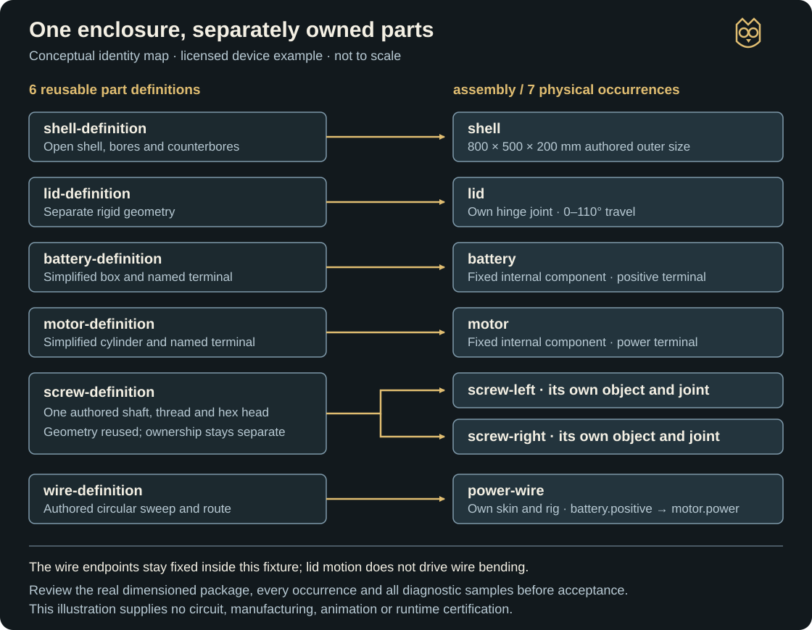
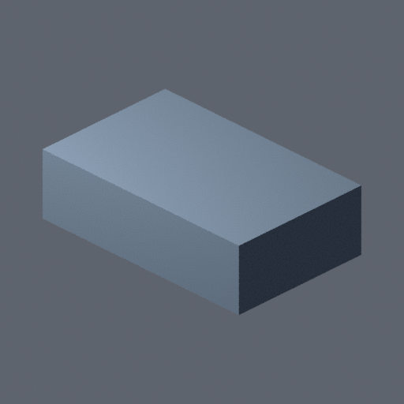
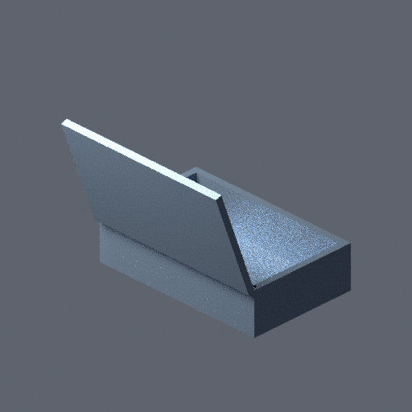

# Schematic to model

`SCHEMATIC_TO_MODEL` creates dimension-driven mechanical assets with independently constructed parts and separately addressable physical instances. Design and approve the complete object, build its part definitions, then assemble and verify its declared rigid and flexible movement. Vehicles, opening devices and curved-hull vessels are supported examples, not promises of complete commercial engineering.

Use the [practical guide source](https://github.com/TimothyMeadows/Hephaera/blob/main/website/content/docs/schematic-to-model.md), [technical host reference](https://github.com/TimothyMeadows/Hephaera/blob/main/docs/SCHEMATIC_TO_MODEL.md), [command arguments](https://github.com/TimothyMeadows/Hephaera/blob/main/commands/BUBO_ARGUMENTS.md#schematic-to-model) and [example walkthrough](https://github.com/TimothyMeadows/Hephaera/tree/main/examples/schematic-to-model). This page is reviewable wiki source; a source merge does not publish GitHub's separate wiki repository.

## Availability and selection

The promoted GitHub release uses package version `5.1.0-rc.1`; that version predates this workflow and does not supply these commands. GitHub's full-release classification neither adds newer source nor removes the package's SemVer prerelease suffix. A baseline version must include the workflow and its reviewed Bubo `7ab99a9f12761095e5a3ee5cfb37d2a679b026a7` pin, verified API/resource/build identity; a later package must explicitly contain those changes. Source merges do not publish a package or move an existing pinned installation. Preserve [package-first installation order](Installation-and-Layout) and the normal managed-update workflow. Do not replace a managed installation with an unrecorded checkout to obtain a new feature.

Read `STYLE.md`, resolve `build-schematic-models` and require compatibility. Select the primary pipeline through an agreed STYLE contract, or record a task-local prompt override without rewriting that contract:

```bash
bash .hephaera/commands/resolve-skill.sh build-schematic-models
bash .hephaera/commands/resolve-art-pipeline.sh --override SCHEMATIC_TO_MODEL --json \
  --evidence .hephaera/.cache/tasks/schematic/pipeline-selection.json
```

The task folder must already exist for its evidence. The coordinating skill is engine-agnostic; selection preserves `ENGINE.md`, the default PROOF_TO_MODEL pipeline and independent AUDIO/MUSIC/VOICE contexts. Pure procedural schematic work needs no MEDIA contract. Generated references follow their separately authorized media workflow. Configured external libraries retain their [read-only search/copy rules](Visual-Pipelines#optional-external-asset-libraries).

## Authority and actual prerequisites

Hephaera owns selection, exact source rights, budgets, approvals, provenance and continuation. Bubo owns dimensional/connectivity validation, drawings, geometry, assembly evaluation, motion proofs and export/re-import checks. The current [runtime lock](https://github.com/TimothyMeadows/Hephaera/blob/main/runtime/bubo.lock.json), actual gitlink, audited resources and explicit clean build must agree. Production never builds source, installs tools or falls back to another checkout implicitly.

```bash
bash .hephaera/commands/initialize-bubo-runtime.sh
bash .hephaera/commands/build-bubo-runtime.sh
```

These commands require existing Git and .NET 10 tools. Admission requires API2 and the complete eleven-operation `portable-assembly-export` capability, including independently constructed parts, assembly, motion, export and the mechanical handoff. A capability declaration is not executable readiness.

Initialization, validation and preview need no Blender. Native construction/export/review require an explicitly selected existing absolute Blender 4.5 LTS path and currently supported 64-bit Windows aggregate committed-memory enforcement. Known prototype, temporary, export/re-import and review paths must fit before authoring starts. Doctor can withhold a selected tool when those paths fail and report that it was not probed. These necessary path checks do not certify every SDK path or actual output quality. No SDK, Blender, model, driver, provider or license is installed/accepted automatically.

## Worked device: prepare, approve and build

Use the licensed native `examples-v2/device.json` for an opening-enclosure exercise. The [practical guide](https://github.com/TimothyMeadows/Hephaera/blob/main/website/content/docs/schematic-to-model.md) introduces its brief and millimetre dimensions. The authoritative source is the [pinned v2 device design](https://github.com/TimothyMeadows/Bubo/blob/7ab99a9f12761095e5a3ee5cfb37d2a679b026a7/resources/schematic-to-model/examples-v2/device.json), rather than a second geometry copy in these docs. It is a simplified procedural QA fixture with no real human asset acceptance.

The shell is 0.8 × 0.5 × 0.2 m with an open cavity; its separate 0.03 m-thick lid starts at Z = 0.2 m. Battery and motor shapes are idealized internal components. There are six definitions, seven physical occurrences and three independent rigid drivers. One screw definition supplies two occurrences. The hierarchy and transforms are explicit even when rigid geometry is reused:

| Occurrence | Definition | Rest-frame origin in parent metres | Articulation or ownership |
| --- | --- | --- | --- |
| `shell` | `shell-definition` | `(0, 0, 0)` | Enclosure reference component. |
| `lid` | `lid-definition` | `(0, 0, 0.2)` | `lid-joint`, local X hinge, 0–110°, rest 0°. |
| `battery` | `battery-definition` | `(0.1, 0.1, 0.05)` | Named `positive` power terminal. |
| `motor` | `motor-definition` | `(0.32, 0.1, 0.05)` | Named `power` terminal; no internal motor simulation. |
| `screw-left` | `screw-definition` | `(0.012, 0.012, 0.14)` | `left-fastener-joint`, local Z screw, 0–720°, pitch 0.002 m/revolution. |
| `screw-right` | `screw-definition` | `(0.77, 0.012, 0.14)` | Separate `right-fastener-joint`, same range and pitch. |
| `power-wire` | `wire-definition` | `(0.198, 0.146, 0.071)` | Separate skin/rig; owns `power-route`. |

All seven design occurrences name subassembly `assembly` as their parent and have zero rest-frame rotation. Joint interfaces additionally declare mechanical parent/child relationships; keep both contracts intact. Each fastener turns two revolutions and advances 0.004 m over its range. That is a declared screw relationship, not evidence of a production-standard thread fit.



*Original explanatory diagram. Definition reuse, instance identities and wire ownership are shown conceptually; this is not a generated drawing, dimensioned construction source or approval artifact.*

`power-route` joins `battery.positive` to `motor.power` through the separately owned `power-wire`. The wire's rest length is 0.12 m, source sweep radius is 0.0015 m and `skinSegments` is 24. Both endpoints stay fixed in this example, so opening the lid does not demonstrate moving-endpoint wire deformation. Preserve the exact route, source rings, endpoint policy and three narrowly declared contact regions. The fixture declares `device-internal-section` at Z = 0.1 m and nonzero explode offsets for inspection. A drawn section at that height does not reveal every lower wire or battery detail; inspect the actual model at useful scales as well.

### Prepare a fresh task version

Run from a real host root with Hephaera at `.hephaera/`, after creating ordinary task `sm` and satisfying the source/runtime prerequisites above. Short IDs reduce known Windows path pressure. The helper needs existing Node and the initialized matching Bubo source; it installs or builds nothing.

```bash
node .hephaera/examples/schematic-to-model/prepare-example.cjs \
  --root . --case device --task sm --asset box --version v1 \
  --geometry-checks 50000000 --timeout-seconds 900 \
  --max-log-bytes 16777216 --max-private-bytes 8589934592

bash .hephaera/commands/schematic-to-model.sh init \
  --task sm --asset box --version v1 \
  --design .hephaera/.cache/tasks/sm/example-inputs/box/v1/design.json \
  --rights .hephaera/.cache/tasks/sm/example-inputs/box/v1/rights.json \
  --budget .hephaera/.cache/tasks/sm/example-inputs/box/v1/budget.json \
  --selection .hephaera/.cache/tasks/sm/example-inputs/box/v1/selection.json

manifest=.hephaera/.cache/tasks/sm/schematic-to-model/box/v1/manifest.json
bash .hephaera/commands/schematic-to-model.sh validate --manifest "$manifest"
bash .hephaera/commands/schematic-to-model.sh preview --manifest "$manifest"
bash .hephaera/commands/schematic-to-model.sh status --manifest "$manifest"
```

Use the manifest actually reported by `init`. All preparer flags are required. These example allowances mean 50 million assembly geometry checks, 900 seconds per operation, 16 MiB of logs and an 8 GiB committed-memory ceiling. Choose explicit values for the actual job before approval. `--geometry-checks` changes only `assemblyProfile.maxGeometryChecks`; source validation, triangle, drawing, sampling and export-byte budgets remain separate and are reported in `preparation.json`.

Expected preparation output is `.hephaera/.cache/tasks/sm/example-inputs/box/v1/` containing `design.json`, licensed `rights.json`, `budget.json`, `selection.json`, `BUBO-LICENSE.txt` and `preparation.json`. The helper binds current STYLE, records exact native ancestry and preserves the MIT notice. It rejects an existing destination; preserve partial/failed folders and use a fresh version. It creates no human decision or native output.

### Inspect the whole preview and record the real decision

Review six dimensioned orthographic views, `device-internal-section`, every independent part sheet, exploded assembly, hierarchical BOM and connection diagram, plus `assembly-details.svg` and `flex-rigs.svg`. Check the seven-occurrence inventory, real bores/counterbores and authored coarse thread, hinge interfaces, both screw ranges/pitch, named electrical ownership, wire policy, contact boxes and explicit simplifications. The source uses a 0.000001 m linear tolerance and 0.01° angular tolerance; passing the design validator does not prove those values survive native construction and portable export.

Obtain actual human approval of the exact complete artifact set. Save `bubo-schematic-review/v1` evidence under the task's review folder, with `kind: whole-assembly-design`, actual `decision`, `human: true`, reviewer/reason, asset/version, exact design SHA-256/fingerprint and the complete `reviewedArtifacts` mapping. Copy current identities from the real preview; do not invent hashes or use a synthetic QA approval.

Only after that decision exists:

```bash
bash .hephaera/commands/schematic-to-model.sh record \
  --manifest "$manifest" --kind whole-assembly-design \
  --reviewer HUMAN_REVIEWER_ID \
  --evidence .hephaera/.cache/tasks/sm/reviews/design-v1.json
```

`record` verifies and preserves the submitted exact-package decision. It does not authenticate a person or create their approval. A rejected or incomplete package stays unapproved.

### Build definitions, then occurrences, then diagnostics

Replace the executable placeholder with the explicitly selected existing absolute Blender 4.5 LTS path. Inspect `doctor` before continuing; execute each subsequent stage only after the preceding stage succeeds.

```bash
blender_executable='C:/path/to/Blender-4.5/blender.exe'
bash .hephaera/commands/schematic-to-model.sh doctor --manifest "$manifest" --blender "$blender_executable"
bash .hephaera/commands/schematic-to-model.sh build-parts --manifest "$manifest" --blender "$blender_executable"
bash .hephaera/commands/schematic-to-model.sh assemble --manifest "$manifest" --blender "$blender_executable"
bash .hephaera/commands/schematic-to-model.sh prove-motion --manifest "$manifest" --blender "$blender_executable"
bash .hephaera/commands/schematic-to-model.sh export --manifest "$manifest" --blender "$blender_executable" --author MODEL_AUTHOR_ID
bash .hephaera/commands/schematic-to-model.sh review --manifest "$manifest" --blender "$blender_executable"
bash .hephaera/commands/schematic-to-model.sh status --manifest "$manifest"
```

Expected results progress from verified per-definition `.blend`/binary prototypes to an editable assembly, then real retained diagnostic actions and sampled geometry. Export seals the animation-free rest package and separate diagnostic-motion package after actual portable-byte and fresh re-import checks. Review renders cover the delivered geometry and every declared diagnostic sample. Doctor capability/path checks alone certify none of those later results.



*Actual retained QA output, rather than a concept render. The closed view hides internals, threads, wire and fastener travel; it cannot establish their presence or movement quality.*



*Actual retained synthetic QA diagnostic sample, not a newly accepted product or finished clip. Thin wire and hidden hardware are not readable at this scale. Inspect the exact bound diagnostic source/GLB with useful close or isolated views and the complete current review set.*

### Review and accept the exact model package

Use the exported `assembly.blend`, animation-free `assembly.glb`, drawings/design, metadata/BOM and separate `diagnostic-motion/` together with technical certificates and all `reviewArtifacts` reported by status. Check all seven actual occurrences, their materials/placement, local pivots, separate screw motion, opening preservation, owned wire skin and attachments, and the full sampled lid range. A single opened frame does not establish intermediate clearance or correct fastener travel.

An independent reviewer distinct from `MODEL_AUTHOR_ID` reviews the current package, raw/re-import evidence and complete views. A real human model decision follows separately. Prepare evidence using `bubo-schematic-model-review/v1`, binding the exact current model/package, rest and diagnostic verification, view receipt and complete artifacts. Human evidence must reference the current approved independent-review hash. The supplied fixture's synthetic decisions cannot fill either real human acceptance record.

```bash
bash .hephaera/commands/schematic-to-model.sh record \
  --manifest "$manifest" --kind independent-model \
  --reviewer INDEPENDENT_REVIEWER_ID \
  --evidence .hephaera/.cache/tasks/sm/reviews/independent-v1.json

bash .hephaera/commands/schematic-to-model.sh record \
  --manifest "$manifest" --kind human-model \
  --reviewer HUMAN_REVIEWER_ID \
  --evidence .hephaera/.cache/tasks/sm/reviews/human-model-v1.json

bash .hephaera/commands/schematic-to-model.sh status --manifest "$manifest"
```

These commands consume existing actual decisions; do not run them with fabricated approved receipts. Current independent review can produce a mechanical handoff. Human model acceptance, finished animation, engine/runtime acceptance and asset promotion remain separate facts.

## Design contracts and construction limits

Use `bubo-assembly-design/v2` with the explicit assembly profile for current assembly/readiness/export. V1 supports design previews and independent part prototypes; its approval does not become v2 assembly approval. The local native authority is `.hephaera/runtime/bubo/resources/schematic-to-model/`:

| Authority | Purpose |
| --- | --- |
| `README.md`, `assembly-design.schema.json` | Closed design shape, coordinates, stable identities, parts/instances, joints, mechanisms, routes and connections |
| `PARTS.md` | Independently constructed parts and the bounded geometric subset |
| `ASSEMBLY.md` | Interfaces, sampled rigid/flexible motion, clearance/contact policy and limits |
| `EXPORT.md` | Portable package, actual re-import checks, complete views and current handoff |

The [reviewed native design](https://github.com/TimothyMeadows/Bubo/blob/7ab99a9f12761095e5a3ee5cfb37d2a679b026a7/resources/schematic-to-model/README.md), [parts](https://github.com/TimothyMeadows/Bubo/blob/7ab99a9f12761095e5a3ee5cfb37d2a679b026a7/resources/schematic-to-model/PARTS.md), [assembly](https://github.com/TimothyMeadows/Bubo/blob/7ab99a9f12761095e5a3ee5cfb37d2a679b026a7/resources/schematic-to-model/ASSEMBLY.md) and [export](https://github.com/TimothyMeadows/Bubo/blob/7ab99a9f12761095e5a3ee5cfb37d2a679b026a7/resources/schematic-to-model/EXPORT.md) links identify the integrated snapshot. Runtime admission always uses the installed lock; do not substitute the URL's revision for actual verification.

Capture purpose, size, appearance/materials, internal systems, moving parts, inspection needs, detail, tolerances and finite budgets. Separate observed reference facts, assumptions, unresolved details and simplifications before approval. References do not establish dimensions automatically. Automatic CAD/raster conversion and image-to-mesh reconstruction are outside this workflow.

Part definitions describe reusable geometry; physical instances describe each actual occurrence, transform, parent and identity. Identical bolts or wheels may share a definition, but every approved occurrence remains separately present and movable. Hardware/detail must be expressed by actual authored features; descriptive prose alone does not create threads or openings.

The fixed part bundle supports parameter-driven boxes/cylinders, convex-profile extrusions/revolves, circular-section sweeps, controlled profile lofts and ordered add/subtract openings. Unsupported, degenerate, self-intersecting or disconnected results fail. Current construction requires a connected closed boundary; fully sealed inner cavity shells require another explicitly authored design. It does not decimate, remesh, widen tolerances or replace missing geometry with a proxy after failure.

Coordinates use metres, right-handed XY and Z up, with explicit local frames and the documented Rz × Ry × Rx convention. Portable glTF uses the recorded Y-up conversion. Preserve approved local precision for small hardware inside large assemblies. Joint angles use degrees, sliders use metres and screw pitch uses signed metres per revolution.

Portable animation translations use [single-precision glTF accessors](https://registry.khronos.org/glTF/specs/2.0/glTF-2.0.html); rounding during export/re-import can exceed a tightly declared tolerance. The verifier must reject that result. Keep the original failure and measured discrepancy. Only an explicit design-requirement revision, new version/parent ancestry and fresh whole-package approval may establish a different numerical policy before rebuilding; it does not satisfy the original precision requirement.

## Rights, limits and immutable host policy

Initialization requires an exact design plus two project-local records:

| Record | Required content |
| --- | --- |
| `hephaera-schematic-rights/v1` | Exact `designSha256`, `owned`/`licensed` status, actual `rightsHolder`, `scope: schematic-to-model`, `evidence` and `referenceInputs` arrays |
| `hephaera-schematic-budget/v1` | Explicit finite safe-integer `timeoutSeconds`, `maxLogBytes`, `maxPrivateBytes` |

Evidence entries contain a local path and exact SHA-256. Reference inputs additionally identify their own rights status/holder/evidence. Licensed inputs require permission evidence; copying a native MIT example does not make it automatically user-owned. Preserve notices and exact source/modification ancestry.

Process limits are timeout 1–86400 seconds, logs 1024–1073741824 bytes and private memory 67108864–68719476736 bytes. They supplement the design's geometry/output/sampling limits; `assemblyProfile.maxGeometryChecks` is distinct from design `budgets.maxValidationChecks`. Choose suitable explicit limits before approval. Continuation does not silently increase them.

The immutable `hephaera-schematic-host-policy/v1` envelope binds design, rights/reference files, budget, STYLE/selection, engine/library and actual runtime/build identity. The native policy inventory permits at most 128 unique references including the envelope; exceeding it fails before that envelope is written. Current manifest/parts/assembly/export state stays writable, not reclassified as immutable input.

## Operations and paths

Run commands from the host root through `bash .hephaera/commands/schematic-to-model.sh`. The wrapper can resolve the installed host; `--root ABSOLUTE_PROJECT` is explicit when needed.

| Operation | Required inputs and meaning |
| --- | --- |
| `init` | `--task ID --asset ID --version ID --design JSON --rights JSON --budget JSON`; optional `--selection TASK_JSON --parent-manifest JSON` |
| `validate` | `--manifest JSON`; native dimensions, connectivity and design evidence |
| `preview` | `--manifest JSON`; complete dimensioned design/drawing/BOM package |
| `doctor` | `--manifest JSON`; optional existing `--blender ABSOLUTE_EXE`, reporting actual prerequisites |
| `record` | `--manifest JSON --kind whole-assembly-design\|independent-model\|human-model --reviewer ID --evidence TASK_JSON` |
| `build-parts` | `--manifest JSON --blender ABSOLUTE_EXE`; independently author/reopen verified part definitions |
| `assemble` | Same manifest/tool; approved v2 design and current verified parts |
| `prove-motion` | Same manifest/tool; current assembly and every declared diagnostic sample |
| `export` | Same manifest/tool plus `--author ID`; seal canonical rest and diagnostic packages after current readiness |
| `review` | Same manifest/tool; complete delivered-geometry and motion views |
| `status` | `--manifest JSON`; current design/parts/assembly/export freshness, including retained tool identity when applicable |

Schematic init takes no actor, arbitrary recipe, toolchain or output-root flag. Unknown/caller-supplied protected execution identities are rejected. There is no setup, arbitrary-script or promotion operation.

The canonical manifest is `.hephaera/.cache/tasks/<task>/schematic-to-model/<asset>/<version>/manifest.json`. The host envelope and native `parts.json`, `assembly.json`, `exports.json` are siblings. Immutable originals and attempted outputs stay in `.art-staging/tasks/<task>/schematic-to-model/<asset>/<version>/`. State/dispatch receipts and reviews remain under the task cache. No model is copied into a game.

## Whole-design approval and part-first assembly

Preview emits six dimensioned orthographic drawings, every declared internal section, independent part sheets, an exploded assembly, connections and hierarchical BOM. V2 adds `assembly-details.svg` and `flex-rigs.svg`. Review every artifact together, including dimensions, local frames, inventory, interfaces, materials/detail, tolerances, limits and simplifications.

Record actual human whole-package approval as `whole-assembly-design` using `bubo-schematic-review/v1`, the exact design/fingerprint and complete artifact mapping. Per-view approvals, a successful validator and synthetic fixture decisions do not grant real human whole-design acceptance. A revision changes the package identity and invalidates affected approval and dependent evidence.

Build each part definition before assembly. Independently reopened prototypes are checked for geometry, materials, dimensions, ownership and approved quantities. Later instances may share that verified geometry while retaining independent objects/transforms. Preserve approved part boundaries, openings, hardware and numerical policy; do not fuse components to pass a budget.

## Joints, mechanisms and flexible geometry

Fixed, hinge, rotary, slider and screw joints name actual parent/child interfaces, explicit axes and limits. Supported coupling families are spur gears, rack-and-pinion, pulley/belt, slider-crank and planar four-bar. Ratios, pitch geometry, linkage lengths and applicable open/crossed branches must be declared. Unsupported/singular closure, incompatible axes, conflicting ownership, broken coupling or invalid travel is rejected.

Each wire, hose, spring or belt occurrence owns actual skin geometry and its deformation rig. The current flexible subset retains the approved circular-sweep source rings; it does not invent extra subdivisions. Check real endpoints/terminal ownership, minimum bend radius, stretch/compression and travel against the design. Electrical support records named terminals, connectors, power/signal relationships and routing, not circuit behavior.

Diagnostic clips sample each independent driver with its coupled followers, endpoints, intermediate/rest poses and full cycles where permitted. Report coverage and measured clearance/contact/deformation evidence. They do not certify arbitrary simultaneous-driver combinations, continuous collision, friction/tension, manufacturing or physics. A rigid cycle need not close a belt's material phase. Diagnostic time is normalized and does not prescribe production speed.

## Portable package and complete model review

The sealed `bubo-schematic-export-package/v1` contains editable `assembly.blend`, animation-free `assembly.glb`, approved design/drawings, `assembly-metadata.json`, hierarchical `bom.json` and provenance. `diagnostic-motion/` separately contains diagnostic Blender, GLB and motion metadata. Every physical occurrence remains separately addressable; each flexible occurrence owns its rig/skin.

Native verification parses the actual portable bytes and independently imports rest and diagnostic GLBs in fresh processes. It compares evaluated positions/topology, part dimensions, quantities, local/world transforms, materials, interfaces, pivots, skin weights/bindings, animation channels and every sampled pose to current construction evidence. Metadata or node counts alone do not establish a geometric match.

Review views cover six orthographic directions, two exterior angles, every declared internal section, an exploded view and every diagnostic sample. If no section was authored, a central inspection cut is a diagnostic image, not an approved design section. Technical/view certificates remain separate from sealed payloads and human decisions.

`independent-model` uses `bubo-schematic-model-review/v1`, a reviewer distinct from the model author, `independent: true`, exact model/package/rest/diagnostic/views hashes and all current `reviewArtifacts`. Separate `human-model` evidence requires actual human judgment and the current independent-review identity. Technical success and synthetic fixtures never create that human decision or runtime acceptance.

## Preserve-only animation handoff

A current independent model decision can issue `bubo-mechanical-assembly-handoff/v1`. It binds package/model/design/metadata/provenance/technical/independent review, actual rest nodes/skins/components and current design/parts/assembly/export state hashes. Optional human-model evidence remains a separate fact.

For explicitly selected [MODEL_TO_ANIMATION](Animation-and-Actions), use recipe `profile: mechanical-assembly`, `rig.mode: preserve`, the exact canonical rest GLB and current `--handoff`. Receiving copies immutable ancestry and rechecks original sources. It preserves every rigid instance, local pivot and flexible rig; no new rig, missing component or retargeting is permitted. Existing skinned/articulated/rigid restrictions remain unchanged.

Relevant state or payload changes invalidate the descriptor; do not silently refresh it. Receiving does not inherit diagnostic clips as finished production animation or supply rig/motion/human runtime approval. Engine-specific playback/collision and asset promotion remain later selected operations; Phaser's 2D path needs an explicit compatible sprite/pre-rendered handoff.

## Revisions, failures and examples

Use a fresh version and `--parent-manifest` for changed design/style/rights/budgets/runtime or affected tool/construction identity. Preserve the exact parent snapshot and old attempts/reviews. Reuse parts only when their definitions and relevant construction inputs are identical and verified. A failed/interrupted latest attempt cannot silently select an older successful result; keep failures and ask status for the actual unavailable step.

Do not delete task cache, widen approved limits after failure, relabel old approvals or switch pipelines/backends silently. Cancellation and owned-child cleanup must be observed, not assumed from a stopped parent command. Cooperative path/file bounds are not an OS sandbox or disk quota.

For the worked enclosure, a request to make the lid thicker, change a screw pitch or move a terminal is a design revision. Prepare fresh `v2` inputs, author the changed design and accurate rights/hash records, then initialize the new version with `--parent-manifest` pointing to `.hephaera/.cache/tasks/sm/schematic-to-model/box/v1/manifest.json`. Use the full `init` arguments from the walkthrough with `--version v2` and the new input paths. Regenerate the complete preview and obtain fresh whole-design approval before construction. Keep v1, its failed or successful attempts and its exact decisions. Reuse only independently verified parts whose definitions and relevant construction inputs remain identical.

| Observed result | What to inspect | Valid continuation |
| --- | --- | --- |
| Command missing in installed `5.1.0-rc.1` | Installed baseline/source version and runtime lock. | Use the supported installation/update path for a version containing the workflow. A GitHub release promotion does not update package contents. |
| `doctor` reports unavailable or tool not probed | Actual selected executable, supported Windows enforcement, prospective prototype/export/review paths and recorded limits. | Resolve the named prerequisite explicitly, then inspect doctor again. Do not silently pick another executable or backend. |
| Part construction fails | Authored feature order, connected closed geometry, profile restrictions, dimensions and latest retained failure. | Correct the actual design in a new version when needed; no proxy, automatic decimation or widened tolerance. |
| Assembly or motion proof fails | Exact interfaces/axes/travel, current parts, contact regions, wire ownership/attachments and measured separation/deformation. | Correct the cause and refresh dependent evidence. Do not omit the failed component or merge parts. |
| Export/re-import exceeds precision or output limits | Actual measured discrepancy, format precision, current numerical policy and cumulative output allowance. | Preserve failure. An explicit requirement/budget revision needs new ancestry and approval; it does not satisfy the former failed requirement. |
| Latest attempt is interrupted or review rejects it | `status`, retained receipt, owned-child cleanup and current source/review hashes. | Preserve that latest state and use an appropriate new attempt/version; an older success is not selected automatically. |
| Handoff no longer validates | Relevant design, parts, assembly, export state, payload and independent-review identities. | Re-establish current evidence and obtain a new valid descriptor before downstream initialization. |

Ask status for the exact failed/stale operation rather than inferring progress from files left on disk. A review-view refresh changes the artifact mapping and needs fresh decisions. Immutable policy changes, including STYLE, rights, budgets, runtime or affected tools, need explicit refreshed ancestry even when the visible shape appears unchanged.

The three prepared examples are an explicitly scoped wheeled platform, an opening electronic enclosure with separate hardware/wire, and a curved hull with rudder/bearing parts. Dedicated mechanism/flexible fixtures exercise additional families. Actual technical Blender/export evidence and automated synthetic review assertions remain distinct from real human production acceptance. These examples are not manufacturing designs, circuit simulations, finished animations or promoted game assets.
