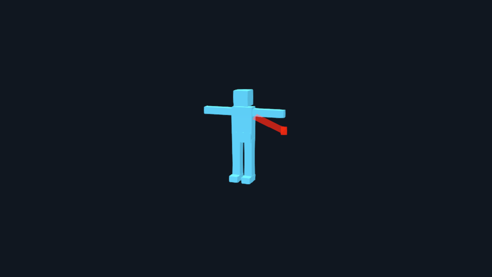
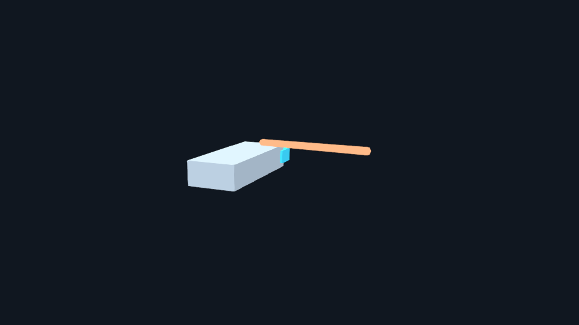
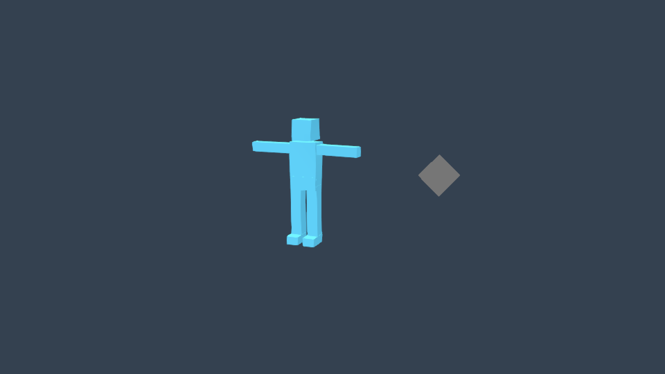

# VFX and action v2

Create reusable reviewed effects, then coordinate them with actual exported model clips. Hephaera owns selection, rights, attempts, phase reviews and continuation. Bubo owns package/resource validation, bounded preparation, action compilation, native receiving verification and the existing promotion implementation. The selected engine owns rendering and scene scheduling. Gameplay keeps targets, movement, collision, hits, damage, costs and outcomes.

Use the [practical guide](https://hephaera.com/docs/game-effects-and-actions/) for an approachable casting example. Exact interfaces live in [VFX assets](https://github.com/TimothyMeadows/Hephaera/blob/main/docs/VFX_ASSETS.md), [Three.js VFX](https://github.com/TimothyMeadows/Hephaera/blob/main/docs/THREEJS_VFX.md), [MODEL_TO_ACTION](https://github.com/TimothyMeadows/Hephaera/blob/main/docs/MODEL_TO_ACTION.md) and the [runtime API](https://github.com/TimothyMeadows/Hephaera/blob/main/.engine/threejs/actions/README.md). Use [the source walkthrough](https://github.com/TimothyMeadows/Hephaera/blob/main/examples/action-vfx/README.md) to follow the records without inventing acceptance.

## Availability and scope

The source integration was reviewed and merged as `6b8c8e6ad6080783763f8fe94e982e248af18807`, with Bubo `a47896d730b32d00b165e61820060e7c73d1ec4a`. The installed gitlink, current lock/API/catalog and verified prebuilt runtime must agree; documentation is not a second pin. Included in stable `5.2.0`. See [Installation and layout](Installation-and-Layout): authenticated GitHub package setup and managed updates first, deliberate manual source installation last. Explicit native builds, engine dependency checks and actual target evidence remain required. Historical `5.1.0-rc.1` keeps its original contents.

| Version/profile | Current scope |
| --- | --- |
| Action v1 | Original native compiler/reader and primitive `orb`, `particles`, `projectile` semantics; historical evidence keeps its original identities |
| Action v2 | Typed reusable effect closure and shared Three.js/Quarks Scene scheduling for reviewed skinned, articulated or rigid motion packages |
| Mechanical assembly | Preserve-only MODEL_TO_ANIMATION handoff; current action composition rejects this mixed profile |
| Other engines | Existing owners remain; no production action-v2 bridge is implied |

STYLE remains the primary art authority and ENGINE the sole engine selector. Resolve `create-game-vfx`, `build-model-actions` and compatible engine skills before production. Selection installs/imports nothing, upgrades no package and chooses no renderer. Source root motion, missing anchors/markers and unsupported interpolation require reviewed correction, without fallback.

## Brief, rights and inexpensive production review

An existing task supplies the durable state. Record intent, actual camera/view distance, model-relative size, attachments, major events, occupied/clear screen regions, blending, quality/accessibility requirements and declared target classes. Bind applicable model, rig, clip, marker and transform files by their exact hashes.

Choose finite particle, system, history, vertex, draw, light, texture, memory, output, concurrency, duration and processing limits. Declare candidate/revision bounds before work. Original media-generation permissions and shared attempt ledgers remain separate; a new effect version cannot renew an allowance.

Host-root examples use the canonical installation:

```bash
bash .hephaera/commands/vfx-assets.sh doctor
bash .hephaera/commands/vfx-assets.sh init \
  --task cast-effects --asset hand-charge --version v1 --creator artist \
  --brief inputs/vfx/brief.json --rights inputs/vfx/rights.json
```

This lifecycle admits owned/licensed fixed inputs. Generated-receipt admission and video decoding remain unavailable. MEDIA still governs separately authorized generation; data staging grants none of it. Inspect configured read-only asset libraries before replacements, copy first through the guarded command and retain asset-level rights.

State lives under `.hephaera/.cache/tasks/<task>/vfx/<asset>/<version>/`; immutable candidates and attempts remain in versioned non-runtime staging. Stage inexpensive `provisional` work, capture the complete requested phase, and obtain a different reviewer's exact independent decision before `detailed` work. The packet binds brief/rights, source/resources, model/clips/markers/transforms, backend/driver/renderer, scene/camera/settings and actual artifacts. A reviewer name or verdict alone is insufficient.

Revisions retain parent ancestry, failed attempts and spent bounds. Relevant changes invalidate affected acceptance; do not rewrite expected hashes. `status` reports retained state. `recover` requires a verified dead writer and preserves interruption/lock evidence; it neither kills a process nor proves untracked native children ended. Preparation has its own process/installer-lease ownership controls.

## Fixed-input preparation and production families

Bubo prepares owned/licensed PNG sheets, exact ordered PNG sequences and typed masks. Specify frame order/count, selected span, rational timing, duration/loop intent, atlas interior/padding, alpha/color interpretation and bounded decoded work. A version has one permanent native preparation claim. Preparation reserves a phase candidate; `stage --preparation` resumes that reservation once rather than charging or granting another attempt. Preserve the native seal and original preparation context.

An engine production profile binds the exact native package and preparation hashes. Keep every prepared resource and nonbinding atlas field exact; additional original resources require direct rights. Bounded RGBA DataTextures/static ungrouped BufferGeometry need actual source-to-decoded correspondence reports. The engine does not hide a general loader, remote fetch or decoder.

| Family | Review emphasis |
| --- | --- |
| Sprite/atlas | Actual frame order/timing, interior aspect, first/last/repeat frames, gutters and transparent edges |
| Burst | Finite release, occupancy and no repeat on resume |
| Ring | Readable silhouette, position and scale |
| Mesh | Declared static source geometry, material correspondence and finite vertices |
| Projectile body | Exact release transform and explicit visual travel |
| Trail | Bounded history, single-cell texture, world path and teleport/discontinuity reset |
| Impact | Rehearsal versus game-supplied contact, surface orientation and bounded window/tail |
| Ground indicator | Essential cue visibility, occlusion and contrast |
| Beam | Explicit endpoint policy, finite width/range, fresh live inputs and input-failure retirement |

These families extend the point/sphere starter helper, not the entire upstream Quarks API. Custom shader strings, arbitrary behaviors, sub-emitters and executable recipe fields are not admitted. Current tested dependencies are Three 0.182.0, three.quarks/quarks.core 0.17.1 and postprocessing 6.39.5; keep exact reviewed installed identities and one Three/core graph. See [Three.js extensions](Threejs-Extensions).

## Compile an action and admit its native source export

Use actual reviewed source clips, the exact source-motion review and real exported anchors/markers. The v2 recipe binds effect packages/profiles/resources plus typed offsets/orientation, positive uniform scale, space, lifetime and target policy. The native export resolves timing and complete dependencies; the host does not recompile source cue addresses. Off-grid release samples the delivered baked clip, not a hypothetical original subframe pose.

`model-to-action.sh inspect-effects --root ROOT --task TASK --recipe RECIPE` reports native source/profile/allocation facts with `accepted: false`. Continue through native init/inspect/compose/export/review/record/validate under actual help. Fixed audited Blender scripts, existing bounded process execution, immutable working copies and resource verification remain required. No hidden build, install or provider fallback occurs.

`action-vfx-runtime-evidence.cjs.admit` runs actual native read-only validation. Review mode returns exact package/model/effect/profile/resource/report bytes with retained context/result/admission identities. Runtime mode additionally requires current native action, independent and human runtime approvals. Both admit only `sourceKind: native-source-export`. The helper does not accept a promoted/rebound destination bundle or implement another native verifier/copy/promotion algorithm. Source verification metadata may remain pending until the separate native promotion operation writes accepted destination metadata.

The host's trusted asset owner loads the exact admitted GLB and decodes the reviewed resources. Arbitrary objects bearing reference-shaped fields are not proof that this admission occurred. Geometry/skin/hierarchy snapshots guard admitted borrowed-model drift within finite copied-byte and comparison-work budgets; actual loader provenance and independent correspondence remain required.

## One Scene owner and clock

Create one action Scene with the existing VFX service. Its claim prevents a second update of that service or underlying Quarks owner. Update authoritative movement and supplied endpoints, advance the Scene scheduler once, then render once through the existing renderer/composer. Actors, ambient effects and finite draining tails share aggregate work/resource limits.

The scheduler evaluates real poses/anchors/endpoints, advances previously active effects for each accepted interval, then dispatches stable equal-time boundaries. New layers receive no earlier elapsed time; stopping layers receive their final interval before emission stops. Scoped actor pause does not freeze unrelated effects. Reentrant replacement/cancellation cannot repeat retired events or let stale generations affect another actor.

Only one presentation owner writes a rig at a time. Motion completion preserves the final delivered pose, stops the mixer and returns rig ownership before finite tails drain. Captured tails freeze at stop; attached tails read their declared anchor. An explicitly declared continue-on-scene layer keeps its own deadlines during actor pause. Cancellation, replacement, reset, actor removal and Scene disposal retire affected resources. Borrowed models/clips/materials/textures, scene service, renderer and composer stay with their owners.

## Targets, beams and confirmed outcomes

Each action start chooses `rehearsal` or `host-outcomes`. Fixed targets are immutable start snapshots. Release uses the real delivered anchor plus authored local transform in right-handed metres, +Y up/+Z forward. Do not apply exporter basis conversion twice. Beam width uses combined uniform scale once; supplied world endpoints determine length.

Continuous beams require generation-bound finite monotonic non-future Scene timestamps, within authored age/range/rate limits. Inputs sample at interval end before FX; missing/stale/invalid inputs retire affected presentation. This grants no homing, collision or target authority.

Rehearsal may show an impact at the planned fixed point. Host-outcomes suppresses that automatic impact. The game may request one reviewed impact with current generation, position, normalized normal and fresh timestamp, only within its active/draining presentation window. The full authored duration, offsets and tail must fit the remaining envelope; late requests fail rather than clipping/stretching. Surface orientation composes the normal frame with the authored local cue rotation. Expired visuals do not invalidate the game's real contact result.

## Receiving evidence and separate acceptance

Capture whole normal-speed skinned and rigid actions, exact boundaries, isolated/combined layers, tails, two actors plus ambient, endpoint policies, interruption/reentrancy and cleanup. Bind actual source/resources, library/modules, backend/driver/renderer, camera/scene/settings and captures. A semantic frame needs its actual requested time; a nearby frame is not an exact-boundary observation.

The host `bindReceiving` operation refreshes read-only native source admission and binds an actual receiving report plus distinct runtime-test, runtime-capture and performance-profile artifacts into the current task cache. It returns a pending-native-review envelope. It records no verdict, human acceptance, runtime dependency copy or promotion.

Receiving library inventory preserves the factual captured report and binds seven exact canonical installed action/particle/postprocessing source modules, including imported helpers. Five native role entries must match their modules. Per-file/combined bounds and current bytes are checked; private copies and silently updated expected hashes cannot replace tested identities. See the [technical packet contract](https://github.com/TimothyMeadows/Hephaera/blob/main/docs/MODEL_TO_ACTION.md#receiving-evidence-and-native-acceptance) for all paths and limits.

Compare at least five comparable baseline/candidate measurements for loading/compile, steady work and peak concurrency. Investigate median-stage regressions above 10% and respect declared absolute budgets. CPU submission, software rendering, physical GPU timing and packaged-device measurements have distinct scopes.

Author reduced-motion/reduced-flash, contrast and color-independent alternatives and review actual playback/readability at peak occupancy. Lower emission alone is not accessibility acceptance. Technical verification, independent production review, human artistic/accessibility/runtime acceptance and explicit native promotion remain separate. No sample in this reference supplies those decisions for a user's asset.

## Original engineering images







These unedited project-authored engineering captures use the reviewed native export and shared Quarks owner. Their [provenance](https://github.com/TimothyMeadows/Hephaera/blob/main/website/assets/guides/README.md) records exact copies. They illustrate selected moments, not finished artwork, complete playback, human acceptance or promotion.

The [original alternative designs](https://github.com/TimothyMeadows/Hephaera/blob/main/examples/action-vfx/accessibility-variants.md) compare lower-cost and steady cues, explain target-plane orientation and distinguish sampled resource peaks from interval-end snapshots.

## Targets and unavailable capabilities

The initial combined renderer is WebGL2/LDR/FXAA. Standalone Quarks WebGL1 observations do not certify this full route. The included engineering frames were captured in Windows x64 Edge 156.0.4314.58 with WebGL2 through ANGLE/Intel Direct3D11. This is one observed desktop configuration, not device-class certification. Report the actual browser/backend/workload; source tests or a software-rendered browser do not certify all desktop GPUs.

MAUI packaging targets Windows, Mac Catalyst, Android and iOS. Each requires actual packaged-game evidence for resource loading, suspend/resume, context recovery, transparency/color, sustained cost and disposal. Browser evidence supplies none of those device results. Linux/TV, WebGPU, ray/path tracing, other-engine action bridges, mixed mechanical actions, optional video decoding and generated-receipt admission are not added here. Missing prerequisites stop explicitly without installation, renderer/provider change or silent fallback.
